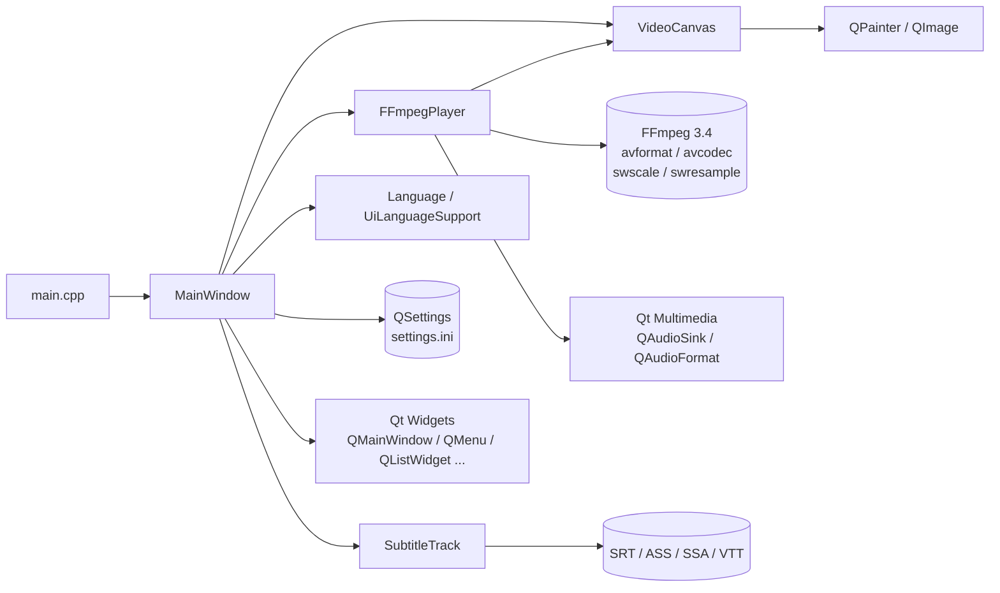
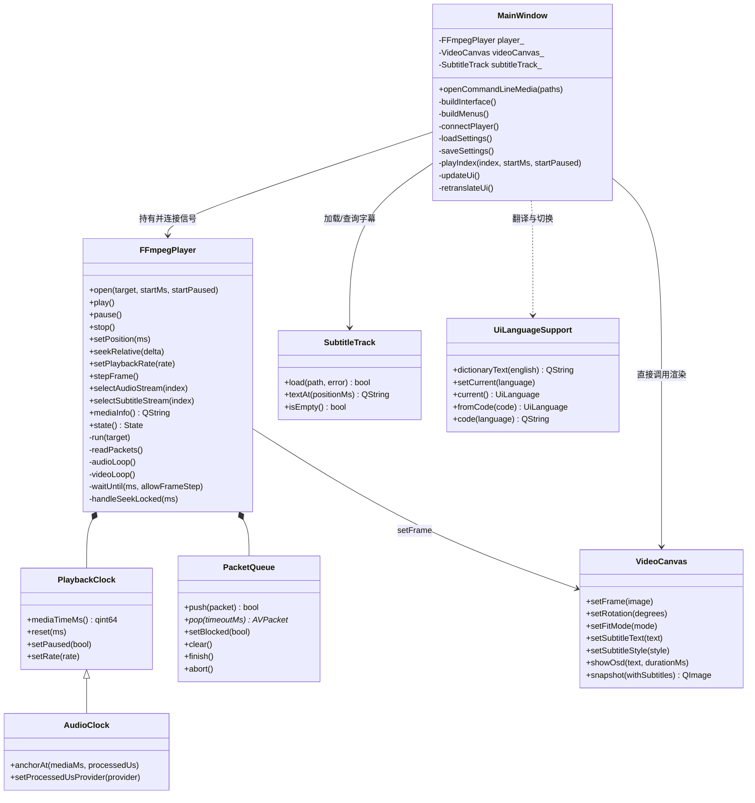
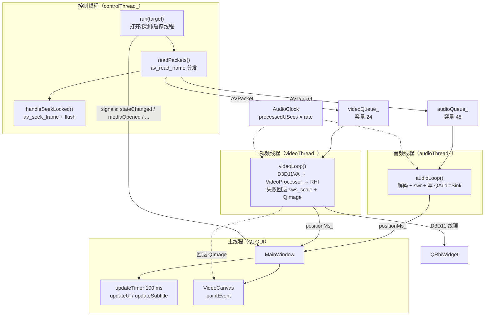
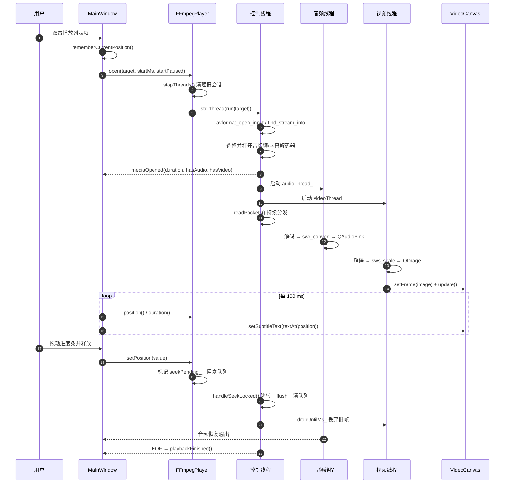
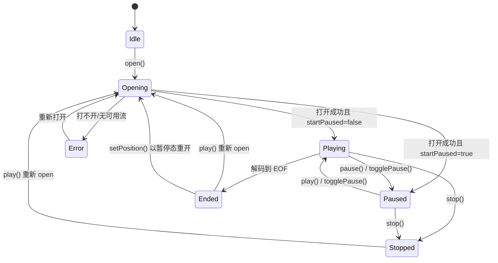
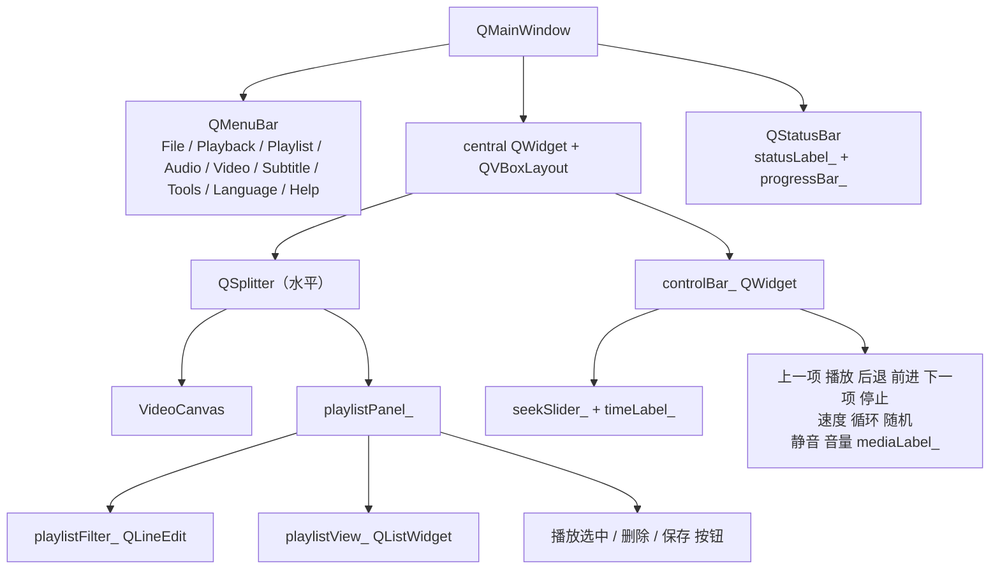
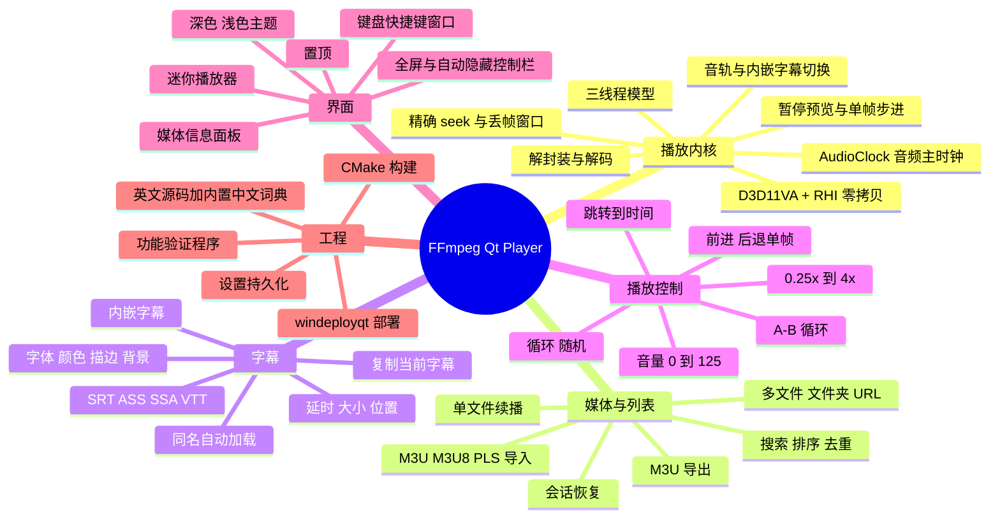

# FFmpeg Qt Player 2.0.0 项目结构导图与代码详解

> 本文档回答三个问题：**整体结构长什么样**、**代码怎么跑起来**、**每个接口和函数在哪里、做什么**。
>
> 阅读顺序建议：先看第 1、2 节建立全景，再按需查第 3 节流程细节，最后把第 4 节当作 API 手册使用。
>
> 版本提示（2026-11-12）：当前源码已加入 `AudioClock`、D3D11VA 硬解、D3D11 VideoProcessor + Qt RHI 零拷贝、`D3d11ContextSync`、`atempo`、热切轨和有界缓存。本文部分早期流程图/索引仍保留旧类名或旧渲染描述，涉及当前播放路径时以 [TECH-STACK.md](TECH-STACK.md)、[README.md](README.md) 和源码为准。

---

## 目录

- [1. 一分钟看懂](#1-一分钟看懂)
- [2. 全景导图](#2-全景导图)
  - [2.1 模块依赖](#21-模块依赖)
  - [2.2 类关系](#22-类关系)
  - [2.3 线程模型与数据流](#23-线程模型与数据流)
  - [2.4 一次播放的时序](#24-一次播放的时序)
  - [2.5 播放状态机](#25-播放状态机)
  - [2.6 界面组件树](#26-界面组件树)
  - [2.7 功能地图](#27-功能地图)
- [3. 代码详解](#3-代码详解)
  - [3.1 程序入口](#31-程序入口)
  - [3.2 MainWindow 的构造与生命周期](#32-mainwindow-的构造与生命周期)
  - [3.3 界面与菜单的搭建](#33-界面与菜单的搭建)
  - [3.4 播放内核 FFmpegPlayer](#34-播放内核-ffmpegplayer)
  - [3.5 视频渲染 VideoCanvas](#35-视频渲染-videocanvas)
  - [3.6 字幕体系](#36-字幕体系)
  - [3.7 播放列表、会话与续播](#37-播放列表会话与续播)
  - [3.8 播放控制增强](#38-播放控制增强)
  - [3.9 窗口形态：主题、全屏、置顶、迷你](#39-窗口形态主题全屏置顶迷你)
  - [3.10 国际化](#310-国际化)
  - [3.11 设置持久化](#311-设置持久化)
  - [3.12 状态刷新与错误处理](#312-状态刷新与错误处理)
- [4. 接口与函数索引](#4-接口与函数索引)
  - [4.1 FFmpegPlayer](#41-ffmpegplayer)
  - [4.2 VideoCanvas](#42-videocanvas)
  - [4.3 SubtitleTrack](#43-subtitletrack)
  - [4.4 UiLanguageSupport](#44-uilanguagesupport)
  - [4.5 MainWindow](#45-mainwindow)
- [5. 信号槽与关键调用链](#5-信号槽与关键调用链)
- [6. 二次开发指南](#6-二次开发指南)
- [7. 已知边界](#7-已知边界)
- [8. 相关文档](#8-相关文档)

---

## 1. 一分钟看懂

这是一个 **Qt 6 Widgets + 自研 FFmpeg 播放内核** 的桌面播放器。正常视频路径由 FFmpeg D3D11VA 硬解，硬件纹理经 D3D11 VideoProcessor 转换后交给 `QRhiWidget` 零拷贝呈现；RHI/VideoProcessor 不可用时回退到 `sws_scale + QImage + QPainter`。音频用 QtMultimedia 的 `QAudioSink` 输出，`swresample` 负责格式重采样，FFmpeg `atempo` 负责保音高倍速。

| 层次 | 文件 | 职责 |
| --- | --- | --- |
| 入口 | `main.cpp` | 创建 `QApplication`，设置组织名/版本/Fusion 风格，显示主窗口并处理命令行媒体 |
| 应用层 | `MainWindow.h/.cpp` | 菜单、工具栏、播放列表、字幕、窗口形态、设置、国际化等所有 UI 逻辑 |
| 播放内核 | `FFmpegPlayer.h/.cpp` | 解封装、D3D11VA/软件解码、音频主时钟、有界队列、弱网状态、seek、热切轨、诊断指标 |
| GPU 渲染层 | `RhiVideoSurface.h/.cpp`、`D3d11ContextSync.h` | Qt RHI、D3D11 VideoProcessor 零拷贝呈现和共享即时上下文同步 |
| 软件回退层 | `VideoCanvas.h/.cpp`、`VideoFramePool.h/.cpp` | 硬件回读/软件解码帧缓存、旋转、缩放、字幕 OSD、快照 |
| 字幕解析 | `SubtitleTrack.h/.cpp` | 独立字幕文件 SRT/ASS/SSA/VTT 的解析与按时间查询 |
| 国际化 | `Language.h/.cpp` | 英文源码字符串 → 中文词典、Qt 基础翻译加载、语言切换 |
| 构建 | `CMakeLists.txt` | 链接 Qt6/FFmpeg，拷贝运行期 DLL、`qtbase_zh_CN.qm`，执行 `windeployqt` |

一句话数据流：

```text
文件/URL → av_read_frame → PacketQueue → 解码线程
  (视频正常) D3D11VA → VideoProcessor → QRhiWidget
  (视频回退) av_hwframe_transfer_data → sws_scale → QImage → VideoCanvas
  (音频)     swr_convert → atempo → QAudioSink
  AudioClock（processedUSecs + 已写帧 PTS）驱动主时钟，无音频时回退 WallClock
```

---

## 2. 全景导图

### 2.1 模块依赖



依赖方向很干净：`MainWindow` 知道所有模块；`FFmpegPlayer` 只认识 `VideoCanvas` 和 FFmpeg/Qt 音频；`VideoCanvas` 不认识播放器；`SubtitleTrack` 不认识 Qt Widgets。

### 2.2 类关系



### 2.3 线程模型与数据流



要点：

- **控制线程**按 `open()` → `run()` 一条命走完：探测流、启动音频/视频线程、自己持续 `readPackets()`，EOF 后推入空包哨兵、`join` 两个解码线程，最后发出 `playbackFinished`。
- **音频线程**每写出一帧 PCM 后按帧时长更新 `positionMs_`；**视频线程**也按帧时间更新，`updatePosition()` 取较大值，因此位置只前进不后退。
- **视频线程**按 `AudioClock` 的节奏出帧，根据帧间隔和近期抖动动态计算迟到阈值；无音频时才由 `WallClock` 驱动。
- 所有跨线程共享量要么是 `std::atomic`，要么有独立互斥量；D3D11 共享即时上下文由 `D3d11ContextSync` 的递归锁和 `ID3D11Multithread` 保护。

### 2.4 一次播放的时序



### 2.5 播放状态机



`State` 定义在 [FFmpegPlayer.h:28](FFmpegPlayer.h#L28)，状态切换统一走 [setState()](FFmpegPlayer.cpp#L683)，因此每次变化都会发出 `stateChanged`。

### 2.6 界面组件树



窗口形态切换（全屏 / 迷你）不会重建控件，只是隐藏或显示 `normalChrome_` 中的菜单栏、控制栏、播放列表面板、状态栏，见 [buildInterface()](MainWindow.cpp#L236) 与 [setMiniMode()](MainWindow.cpp#L2026)。

### 2.7 功能地图



---

## 3. 代码详解

### 3.1 程序入口

[main.cpp](main.cpp) 只有 18 行，职责明确：

1. 创建 `QApplication`；
2. 设置 `FFmpegQtPlayer` / `FFmpeg Qt Player` / `2.0.0`，供 `QSettings` 定位配置目录；
3. 使用 `Fusion` 风格，保证深色 QSS 在各 Windows 版本上表现一致；
4. 显示 `MainWindow`；
5. 把 `application.arguments().mid(1)` 交给 [openCommandLineMedia()](MainWindow.cpp#L229)，支持“右键用本程序打开”和拖到 exe 上播放。

### 3.2 MainWindow 的构造与生命周期

构造函数 [MainWindow::MainWindow()](MainWindow.cpp#L153) 的顺序不能随意调换：

```text
注册元类型
→ 窗口标题/拖放/初始尺寸
→ buildInterface()     创建所有控件与控件间连接
→ buildMenus()         创建动作、快捷键、菜单
→ configureStyle()     应用深/浅色 QSS
→ connectPlayer()      连接播放器信号
→ loadSettings()       读取配置、恢复会话、恢复续播表
→ recordUiTexts()      登记所有待翻译文本
→ 设置占位文字、按需切换中文
→ player_->setVideoCanvas() / 音量 / 倍速 / 静音图标
→ 启动 100 ms updateTimer_
→ updateState / updatePlaylistButtons / updateStatus
→ uiReady_ = true
→ 若上次会话有效则 playIndex(..., startPaused=true)
```

几个容易忽略的设计：

- `uiReady_` 在所有初始化完成前为 `false`，避免 `loadSettings()` 期间滑块 `valueChanged` 弹出 OSD。
- 会话恢复使用 `playIndex(sessionIndex_, sessionPosition_, true)`，**以暂停态打开**，不会一启动就出声。
- 析构函数 [~MainWindow()](MainWindow.cpp#L221) 先 `setVideoCanvas(nullptr)` 再 `stop()`，防止视频线程在画布销毁后仍调用 `setFrame()`。

### 3.3 界面与菜单的搭建

#### 3.3.1 布局

[buildInterface()](MainWindow.cpp#L236) 搭建“左视频、右播放列表、下控制栏、底状态栏”的结构：

- `QSplitter` 左 `VideoCanvas`、右 `playlistPanel_`，拉伸因子 `1:0`，默认 `{850, 300}`。
- 播放列表面板包含标题、数量标签、搜索框 `playlistFilter_`、`QListWidget`、三个工具按钮。
- 控制栏分两行：进度条 + 时间；传输按钮、速度、循环/随机、音量、媒体名。
- 控制栏是**紧凑自适应**的：可压缩控件统一 `QSizePolicy::Ignored`，窗口变窄时由 [updateCompactChrome()](MainWindow.cpp#L1660) 按阈值依次隐藏倍速（< 820）、循环/随机（< 780）、音量滑块与标签（< 740）、媒体名（< 700），媒体名用 `elidedText` 按可用宽度省略中段。窗口最小尺寸 640×400 逻辑像素。
- 所有可交互控件显式 `setFocusPolicy(Qt::NoFocus)`，防止空格、方向键被按钮/滑块吃掉。
- 进度条拖动采用“按下只更新标签、释放才 seek”的策略（[sliderPressed/sliderReleased](MainWindow.cpp#L460)），拖动过程中 `updateUi()` 不会把滑块拉回去。
- 播放列表支持内部拖拽排序，`rowsMoved` 触发 [syncPlaylistOrder()](MainWindow.cpp#L1603) 把视图顺序写回 `playlist_`。

#### 3.3.2 菜单与快捷键

[buildMenus()](MainWindow.cpp#L542) 一次性创建全部 `QAction`，菜单结构：

| 菜单 | 主要动作 |
| --- | --- |
| File | 打开文件、添加文件、打开文件夹、打开网络流、最近文件、打开/保存播放列表、退出 |
| Playback | 播放/暂停、下一帧、上一帧、跳转到时间、停止、上/下一项、±5 秒、倍速、循环、随机、A-B 循环 |
| Playlist | 播放选中、删除选中、清空、搜索、按标题/路径排序、去重 |
| Audio | 静音、音量 ±、50/100/125%、音轨切换 |
| Video | 全屏、置顶、快照、画面比例 |
| Subtitle | 加载字幕、字幕样式、复制当前字幕、显示开关、内嵌轨道、延时、大小、位置、快照包含字幕 |
| Tools | 媒体信息、定位当前文件、播放列表面板、浅色主题、迷你播放器 |
| Language | English / 简体中文 |
| Help | 键盘快捷键、关于 |

`Esc` 单独注册为窗口级动作，优先级为“退出全屏 → 退出迷你 → 无操作”，动作在 [buildMenus()](MainWindow.cpp#L740) 中创建、在 [buildMenus()](MainWindow.cpp#L851) 中连接。

### 3.4 播放内核 FFmpegPlayer

头文件：[FFmpegPlayer.h](FFmpegPlayer.h)；实现：[FFmpegPlayer.cpp](FFmpegPlayer.cpp)。

#### 3.4.1 三个线程各做什么

| 线程 | 入口 | 生命周期 | 职责 |
| --- | --- | --- | --- |
| 控制线程 | [run()](FFmpegPlayer.cpp#L838) | `open()` 创建，EOF/stop/析构时结束 | 打开输入、探测流、打开解码器、建队列、启动音视频线程、`readPackets()`、收尾 |
| 音频线程 | [audioLoop()](FFmpegPlayer.cpp#L1233) | `run()` 中启动，读到哨兵/abort 后退出 | 解码音频、重采样、写 `QAudioSink`、推进媒体位置 |
| 视频线程 | [videoLoop()](FFmpegPlayer.cpp#L1480) | 同上 | 解码视频、按主时钟等待、丢弃过期帧；正常提交 D3D11 纹理，失败时回读为 `QImage` |

`stopThreads()`（[FFmpegPlayer.cpp:689](FFmpegPlayer.cpp#L689)）是唯一的停机入口：置 `abort_`、唤醒并中止两个队列、`join` 控制线程、关闭队列、复位解码线程句柄。

#### 3.4.2 两个基础设施类

**`PlaybackClock` / `AudioClock` / `WallClock`**（[PlaybackClock.cpp](PlaybackClock.cpp)）

- `AudioClock` 以最近写入音频帧的媒体 PTS 为锚点，结合 `QAudioSink::processedUSecs()` 和倍率计算当前媒体时间；
- `WallClock` 保留给无音频或音频设备不可用的回退路径；
- `setPaused()`、`reset()` 和 `setRate()` 都会重新建立锚点，避免暂停、seek 或倍速切换后继续使用旧时间轴；
- 视频线程只读取统一主时钟，帧迟到超过动态阈值时丢帧追赶。

**`PacketQueue`**（[FFmpegPlayer.cpp:262](FFmpegPlayer.cpp#L262)）

- 固定容量：音频 48 包、视频 24 包（[FFmpegPlayer.cpp:1036](FFmpegPlayer.cpp#L1036)）；
- `push()` 在满时阻塞，`abort_/blocked_/finished_` 都会唤醒；
- `pop(timeoutMs)` 默认等 50 ms，返回 `nullptr` 让解码线程继续轮询；
- `setBlocked(true)` 用于 seek 期间阻止生产者继续塞包；
- `finish()` + 空包哨兵用于 EOF 后让解码器把缓存帧吐干净；
- `clear()` 直接释放所有残留 `AVPacket`。

#### 3.4.3 打开流程 `open()` / `run()`

[open()](FFmpegPlayer.cpp#L382)：

1. `stopThreads()` 结束上一场播放；
2. 复位所有原子状态：`abort_`、`seekRequestMs_`、`dropUntilMs_`、`videoStepCount_` 等；
3. 记录目标、起始位置、是否暂停，清空媒体信息与轨道列表；
4. `opening_ = true`，设置 30 秒打开超时；
5. 创建回退 `WallClock(startPositionMs)`；音频设备就绪后切换到 `AudioClock`；
6. 启动控制线程 `run(target)`。

[run()](FFmpegPlayer.cpp#L838)：

1. `avformat_open_input` + `avformat_find_stream_info`，设置中断回调；
2. 遍历所有流，收集可用音轨与**文本字幕**轨（`isTextSubtitleCodec`）；
3. 打开视频/音频/字幕解码器，记录尺寸、帧率、旋转角、采样率、声道数；
4. 若音视频都没有，关闭资源并进入 `Error`；
5. 计算时长（容器时长优先，否则取各流最大值）；
6. 若起始位置 > 0，先 `av_seek_frame(..., AVSEEK_FLAG_BACKWARD)` 并 flush 三个解码器；
7. 创建音视频队列，组装媒体信息；
8. 发出 `mediaInfoChanged`、`mediaOpened`；
9. 启动音视频线程，设置 `Playing` 或 `Paused`；
10. 进入 `readPackets()`；
11. EOF 后推入空包、`finish()`、`join` 解码线程、关闭解码器与输入；
12. 非 abort 情况下置 `Ended` 并发出 `playbackFinished`。

#### 3.4.4 解封装 `readPackets()`

[readPackets()](FFmpegPlayer.cpp#L1186) 是控制线程的主循环：

```text
while (!abort_):
    seekRequestMs_ 有值 → handleSeekLocked()
    av_read_frame()
    字幕包 → decodeSubtitlePacket() 立即解码入 cue 表
    音频包 → audioQueue_->push()
    视频包 → videoQueue_->push()
    其它包 → 直接释放
```

SEEK 请求在**每次读包前**检查，因此 seek 不会被阻塞在 `av_read_frame` 里；同时 `PacketQueue::setBlocked(true)` 会在 seek 期间阻止队列继续增长。

#### 3.4.5 帧同步 `waitUntil()`

[videoLoop()](FFmpegPlayer.cpp#L1480) 和 [audioLoop()](FFmpegPlayer.cpp#L1233) 都调用 [waitUntil()](FFmpegPlayer.cpp#L1640)：

- `abort_` 或 `seekPending_` → 立即返回 `false`，当前帧丢弃；
- 暂停状态下，只有 `allowFrameStep && videoStepCount_ > 0` 才放行；
- 否则比较 `clock_->mediaTime()` 与目标帧时间，把差值**除以倍速**换算成墙上睡眠，每次最多睡 10 ms。

除以倍速是关键修正：2x 时若仍按媒体时间睡，视频会明显落后；0.5x 时则会出现音频欠载。

#### 3.4.6 音频线程

[audioLoop()](FFmpegPlayer.cpp#L1233) 的流程：

1. 解码循环：`avcodec_receive_frame` → EAGAIN 时从队列取包 `avcodec_send_packet`；
2. 用 `frameTimeMs()` 得到帧时间，`dropUntilMs_` 之前的帧丢弃；
3. `ensureOutput()` 按源采样率（受设备能力约束）创建 `QAudioSink`，默认 `Int16` 双声道；设备不支持时退回首选格式并强制 16 位；
4. **倍速通过重采样实现**：`swr` 的输入速率设为 `sourceRate × rate`，输出速率保持设备速率，因此设备无需重建；
5. `applyVolume()` 按 0–125 的增益缩放 PCM，静音时增益 0；
6. 写设备时若暂停会中途跳出，避免暂停后还播完整个缓冲区；
7. 成功写入后按**源帧时长**更新 `positionMs_`（不是重采样后的时长）。

暂停时调用 `sink->suspend()`，恢复时 `resume()`，避免反复销毁音频设备。

#### 3.4.7 视频线程与三种“暂停出帧”

[videoLoop()](FFmpegPlayer.cpp#L1480) 的状态判断：

```cpp
const bool pausedNow   = paused_.load();
const bool stepping    = pausedNow && videoStepCount_.load() > 0;
const bool previewing  = pausedNow && previewPending_.load();
if (pausedNow && !stepping && !previewing) { sleep(5ms); continue; }
```

- **正常播放**：`waitUntil(frameMs, true)` 控制节奏；若 `clock_->mediaTime() - frameMs > 150`，说明解码落后，直接丢帧，避免“补课式”突然加速。
- **暂停预览**：seek 后若处于暂停态，`handleSeekLocked()` 置 `previewPending_`，视频线程只解一帧并显示，然后复位时钟为暂停。
- **单帧步进**：`stepFrame()` 让 `videoStepCount_` 加一，最多累积 8 帧；视频线程显示一帧后减一，并复位时钟。

`sws_scale` 的目标格式是 `AV_PIX_FMT_BGRA`，与 `QImage::Format_ARGB32` 内存布局一致；缩放器按源宽高/像素格式缓存，只在变化时重建。

#### 3.4.8 Seek 的实现

[setPosition()](FFmpegPlayer.cpp#L483) 只做“登记”，不做实际跳转：

- 播放已结束（`Ended`）时，以目标位置 **暂停重开**，保证进度条仍可用；
- 其它非活动状态直接忽略；
- 把目标夹在 `[0, duration]`（时长未知时只保证非负）；
- 写入 `seekRequestMs_`、置 `seekPending_`、立刻更新 `positionMs_`（UI 立即响应）；
- 阻塞两个队列。

真正的跳转在控制线程的 [handleSeekLocked()](FFmpegPlayer.cpp#L1730) 中：

1. `av_seek_frame(formatContext_, -1, target, AVSEEK_FLAG_BACKWARD)`；
2. 成功后 flush 音频/视频/字幕解码器；
3. 清空并解除两个队列的阻塞；
4. 复位 `positionMs_`、设置 `dropUntilMs_ = target`；
5. 若当前暂停且有视频，置 `previewPending_ = true`；
6. `clock_->reset(target)` 并按暂停态冻结。

丢帧窗口保证 seek 后解码器吐出的旧关键帧不会被显示；音频侧只丢弃 `frameMs + 40 < dropUntilMs_` 的帧，留出 40 ms 容差避免切掉目标附近的有效音频。

#### 3.4.9 轨道切换与内嵌字幕

- [selectAudioStream()](FFmpegPlayer.cpp#L546) / [selectSubtitleStream()](FFmpegPlayer.cpp#L554)：记录请求索引，调用 [reloadAtCurrentPosition()](FFmpegPlayer.cpp#L739) 在当前位置以暂停态重开；
- 打开时若 `requestedSubtitleStream_ == -1`，默认选第一条文本字幕轨；`-2` 表示关闭内嵌字幕（菜单中的 “None / Automatic”）；
- 字幕包在 `readPackets()` 中直接解码，[decodeSubtitlePacket()](FFmpegPlayer.cpp#L762) 把 cue 写入 `embeddedCues_` 并排序；
- [embeddedSubtitleTextAt()](FFmpegPlayer.cpp#L644) 用 `std::upper_bound` 找到最后一个 `startMs <= position` 的 cue，再判断是否在 `endMs` 内，复杂度 O(log n)。

#### 3.4.10 打开超时与中断

`AVFormatContext::interrupt_callback` 指向 [interruptCallback()](FFmpegPlayer.cpp#L717)：`abort_` 为真或打开超过 30 秒时返回 1，FFmpeg 会中止阻塞中的网络/磁盘操作。这保证关闭窗口或切换媒体时不会卡死在坏链路上。

### 3.5 视频渲染 VideoCanvas

[VideoCanvas](VideoCanvas.h) 是一个纯 `QWidget`，所有绘制都在 [paintEvent()](VideoCanvas.cpp#L348) 中完成：

1. 加锁拷贝当前帧、字幕、占位文字、OSD、缩放模式、字幕样式；
2. 无帧时画深色背景 + 居中占位文字；
3. 有帧时按 `FitMode` 计算目标矩形并 `drawImage`；
4. 在视频矩形内绘制字幕；
5. 右上角绘制半透明 OSD（倍速、音量、续播提示等）。

帧的线程安全：`setFrame()` 加锁替换 `frame_`、使旋转缓存失效，然后走 [scheduleRepaint()](VideoCanvas.cpp#L47) —— 用 `std::atomic<bool>` 做“最多一次排队”的合并，避免解码线程在帧率高时把 `update()` 事件堆满主线程事件队列。`paintEvent` 只持有锁做浅拷贝，绘制在锁外进行，避免阻塞视频线程。

窗口缩放时有两条专门的路径，对应“缩放卡顿 / 边缘残影 / 闪烁”：

- [resizeEvent()](VideoCanvas.cpp#L415) 里临时关闭 `SmoothPixmapTransform` 并以整帧 `update()` 强制全量重绘——Qt 默认只重绘新暴露的条带，对带 `WA_OpaquePaintEvent` 的画布会留下旧帧边缘；关闭平滑采样则让拖动窗口期间用最近邻快速缩放，保证 60 fps 跟手。120 ms 无新的 resize 后由 `resizeSettleTimer_` 恢复平滑采样并再画一帧，静止画面回到高质量。
- [targetRectFor()](VideoCanvas.cpp#L241) 返回的矩形按整数像素对齐（`qRound` 宽高与居中偏移），否则亚像素的黑边边界在缩放过程中会抖动成一条发亮的细线。

旋转处理在 [orientedFrameLocked()](VideoCanvas.cpp#L194)：FFmpeg 的 display matrix 是逆时针角度，而 `QTransform::rotate()` 正角为顺时针，所以取负；结果按 `(frame_, rotation)` 缓存，旋转不变时不重复变换。

缩放模式由 [targetRectFor()](VideoCanvas.cpp#L241) 计算：适应、裁剪填充、拉伸、16:9、4:3、原始尺寸，全部居中。

快照 [snapshot()](VideoCanvas.cpp#L213) 复制当前帧，可选把字幕直接画进图片，供 `MainWindow::takeSnapshot()` 保存 PNG。

交互信号：双击 → 全屏；滚轮 → 音量步进；右键 → 上下文菜单；拖入文件 → `mediaDropped`。

### 3.6 字幕体系

字幕有三条来源，优先级从高到低：

1. **独立字幕文件**（`SubtitleTrack`）：用户手动加载，或打开媒体时自动查找同名 `.srt/.ass/.ssa/.vtt`（[loadSidecarSubtitle()](MainWindow.cpp#L3188)）；
2. **内嵌文本字幕**（`FFmpegPlayer`）：随容器解码，支持 SubRip、ASS/SSA、MOV_TEXT、WebVTT 等；
3. 无字幕。

#### 3.6.1 SubtitleTrack

[SubtitleTrack::load()](SubtitleTrack.cpp#L70) 按扩展名选择 [parseSrt()](SubtitleTrack.cpp#L143) 或 [parseAss()](SubtitleTrack.cpp#L188)，解析后 [normalize()](SubtitleTrack.cpp#L222) 排序并裁剪重叠区间；[textAt()](SubtitleTrack.cpp#L118) 二分查找当前时间对应的 cue。

#### 3.6.2 显示刷新

[updateSubtitle()](MainWindow.cpp#L3119) 每 100 ms 由 `updateUi()` 调用：

```cpp
if (!embeddedSubtitlesVisible_) { clear; return; }
const qint64 shifted = positionMs - subtitleDelayMs_;
QString text = subtitleTrack_ && !subtitleTrack_->isEmpty()
    ? subtitleTrack_->textAt(shifted)
    : player_->embeddedSubtitleTextAt(shifted);
if (text != subtitleText_) { subtitleText_ = text; videoCanvas_->setSubtitleText(text); }
```

只有文本变化才触碰画布，避免每 100 ms 触发重绘。

#### 3.6.3 样式

`VideoCanvas::SubtitleStyle`（[VideoCanvas.h:34](VideoCanvas.h#L34)）包含字体、文字色、描边色、描边宽度、背景色、背景不透明度。默认值：白色文字、黑色描边 0、黑色背景 180/255。

[showSubtitleStyleDialog()](MainWindow.cpp#L2873) 提供字体下拉、三个颜色按钮、描边宽度 0–8、背景透明度 0–100 滑块；`collect` 实时更新 `subtitleStyle_` 并调用 [applySubtitleStyle()](MainWindow.cpp#L2866) 预览，取消时恢复旧值，恢复默认时把字体显式重置为 `Segoe UI`。

[drawSubtitle()](VideoCanvas.cpp#L286) 的排版：

- 字号 = `clamp(视频宽度 / 42 × 缩放, 14, 72)`；
- 文本按最大宽度自动换行、水平居中；
- 背景为圆角矩形，透明度来自样式；
- 描边通过在 `±outlineWidth` 的 9 个偏移位置重复绘制文字实现；
- 底部边距按视频高度的比例计算，并限制在 `[8, 高度/2]`。

### 3.7 播放列表、会话与续播

#### 3.7.1 数据结构

```cpp
struct PlaylistEntry {
    QString target;   // 本地路径或 URL
    QString title;    // 显示名
    bool isUrl = false;
};
QVector<PlaylistEntry> playlist_;
int currentIndex_ = -1;
```

视图 `playlistView_` 与模型 `playlist_` **行号一一对应**：搜索过滤用 `QListWidgetItem::setHidden()` 而不是移除项，排序/去重后才通过 [rebuildPlaylistView()](MainWindow.cpp#L2601) 重建。

#### 3.7.2 添加与展开

- [addPaths()](MainWindow.cpp#L2254)：逐个 [expandPath()](MainWindow.cpp#L2294)；
- `expandPath()`：目录则递归收集支持的媒体；`.m3u/.m3u8/.pls` 走 [loadPlaylist()](MainWindow.cpp#L2326)；其它可播放文件生成 entry；
- [appendPlaylistEntry()](MainWindow.cpp#L2404)：去重后追加，按需立即播放；
- 打开模式 `Replace` / `Append` 决定是否先清空。

#### 3.7.3 播放与续播

[playIndex()](MainWindow.cpp#L2417)：

1. `rememberCurrentPosition()` 记住当前项；
2. 若调用方未指定起点，查询 `resumePositions_`，且位置 > 5 秒才使用；
3. 清除 A-B 点、重置字幕与画布；
4. `player_->open(target, startMs, startPaused)`；
5. 自动加载同名字幕、刷新标题/按钮/状态。

[rememberCurrentPosition()](MainWindow.cpp#L2451) 的写入条件：

- 本地文件（URL 不记）；
- 状态为 `Playing` 或 `Paused`；
- `position > 5000` 且 `position < duration - 3000`；
- 最多保留 100 条，超出时淘汰最早插入项。

恢复时机在 `mediaOpened` 回调（[MainWindow.cpp:1158](MainWindow.cpp#L1158)）：若恢复点距离结尾不足 1 秒则回到 0；否则显示“Resumed at …”OSD。

会话恢复与会话位置是另一套机制：`session/items` 保存整个列表，`session/current` 与 `session/position` 保存上次播放项与位置，启动时以暂停态打开。

#### 3.7.4 搜索、排序、去重

| 功能 | 实现 | 关键点 |
| --- | --- | --- |
| 搜索 | [filterPlaylist()](MainWindow.cpp#L2568) | 同时匹配标题和路径，大小写不敏感；隐藏而非删除 |
| 聚焦搜索 | [focusPlaylistSearch()](MainWindow.cpp#L2584) | 迷你模式下先退出迷你；面板隐藏则先显示 |
| 排序 | [sortPlaylist()](MainWindow.cpp#L2621) | `std::stable_sort`，标题/路径为主键、另一字段为次键；按 target 重新定位 `currentIndex_` |
| 去重 | [removeDuplicateEntries()](MainWindow.cpp#L2661) | URL 精确匹配、本地路径忽略大小写，保留首次出现；当前项被删时按 target 重新定位 `currentIndex_` |
| 顺序同步 | [syncPlaylistOrder()](MainWindow.cpp#L1603) | 拖拽后把视图行序写回 `playlist_`，`syncingPlaylistOrder_` 防止递归 |

### 3.8 播放控制增强

#### 3.8.1 A-B 循环

状态：`repeatStartMs_`、`repeatEndMs_`、`repeatJumping_`。

- [setRepeatPointA()](MainWindow.cpp#L2780)：取当前位置为 A；若 B 不再大于 A 则清空 B；
- [setRepeatPointB()](MainWindow.cpp#L2794)：要求已设 A，且 B 至少比 A 晚 200 ms；
- [repeatActive()](MainWindow.cpp#L2775)：`A >= 0 && B > A`；
- 循环判断在 [updateUi()](MainWindow.cpp#L3027)：位置到达 B 且正在播放时跳到 A；
- `repeatJumping_` 是防抖锁：跳转后位置可能短暂仍 ≥ B，等位置回落到 B-400 以下才解锁；
- 切换媒体时（`playIndex`）自动清除 A/B。

#### 3.8.2 前进/后退单帧

- 前进：[stepOneFrame()](MainWindow.cpp#L2736) 先暂停再 `player_->stepFrame()`；
- 后退：[stepPreviousFrame()](MainWindow.cpp#L2753) 先暂停，按 `videoFrameRate()` 计算一帧间隔（`clamp(1000/fps, 10, 100)` ms），再 `setPosition(position - interval)`；
- 后退利用的是“暂停态 seek 预览”：跳转后视频线程只解一帧显示，因此画面立即更新且不继续播放。

#### 3.8.3 跳转到时间

[goToTime()](MainWindow.cpp#L2827) 弹出输入框，[parseTimeText()](MainWindow.cpp#L109) 支持：

- 纯秒数：`90`、`12.5`；
- `MM:SS`、`HH:MM:SS`；
- 各段可带小数，按 60 进制累加。

解析成功后调用 `setPosition()`，非法输入通过状态栏和 OSD 提示。

### 3.9 窗口形态：主题、全屏、置顶、迷你

#### 3.9.1 主题

- [configureStyle()](MainWindow.cpp#L863) 内含深色与浅色两套完整 QSS；
- [setDarkTheme()](MainWindow.cpp#L1144) 更新 `darkTheme_`、重新应用 QSS、刷新播放列表项颜色；
- `loadSettings()` 读取 `ui/theme`，`saveSettings()` 写回 `dark`/`light`；
- 浅色主题菜单项是“反选”语义：勾选 = 浅色。

#### 3.9.2 全屏

[toggleFullscreen()](MainWindow.cpp#L1889) 保存窗口状态与几何，隐藏 `normalChrome_`，进入全屏；[enterFullscreenChrome()](MainWindow.cpp#L1917)、[exitFullscreenChrome()](MainWindow.cpp#L1945)、[updateFullscreenChromeGeometry()](MainWindow.cpp#L1967) 负责把控制栏叠加到画布底部；[showFullscreenChrome()](MainWindow.cpp#L1982) / [hideFullscreenChrome()](MainWindow.cpp#L1994) 由 2.5 秒单次定时器 [restartFullscreenChromeTimer()](MainWindow.cpp#L2007) 驱动自动隐藏。

全屏切换的顺序是刻意安排的，之前的“布局错位 / 闪黑”就出在这里：

- **先进全屏再摆浮层**：`enterFullscreenChrome()` 先 `showFullScreen()`，再用 `QTimer::singleShot(0, ...)` 在窗口管理器真正改完几何之后调用 `updateFullscreenChromeGeometry()`，避免用旧尺寸算出偏左/偏高的控制栏；同一回调里强制 `videoCanvas_->update()`，消掉切换瞬间的黑帧。
- **退出只切一次窗口状态**：旧实现先 `showNormal()` 再 `showMaximized()`，中间会闪出一帧普通窗口；现在按 `wasMaximized_` 一次性 `showMaximized()` 或 `showNormal()`，随后 `exitFullscreenChrome()` 里补一次 `updateCompactChrome()` 与画布重绘，恢复出与进入前一致的窗口。
- **播放列表面板在全屏时不允许弹出**：`playlistAction_` 的槽加了 `&& !fullscreen_`，否则全屏下勾选动作会把侧栏叠在画布上。
- 控制栏从 `centralWidget()` 取出后重新设为画布覆盖层，退出时重新加入布局，副作用由 [updateFullscreenChromeGeometry()](MainWindow.cpp#L1967) 统一收敛。

#### 3.9.3 置顶与迷你

- [toggleTopmost()](MainWindow.cpp#L2014)：切换 `Qt::WindowStaysOnTopHint`；
- [setMiniMode()](MainWindow.cpp#L2026)：保存几何与置顶状态 → 隐藏菜单/状态栏/播放列表 → 强制置顶 → 缩小到 560×340、最小 400×260；退出时恢复菜单、面板可见性、置顶与几何，并把最小尺寸还原为 640×400（与主窗口一致，否则退出迷你后无法再缩到窄窗口）；
- 迷你模式下 `playlistAction_` 不会重新显示面板（`checked && !miniMode_ && !fullscreen_`）；
- 保存设置时若仍在迷你模式，写入的是进入迷你前的几何与置顶状态（[saveSettings()](MainWindow.cpp#L1344)）。

### 3.10 国际化

设计目标：**源码保持英文、运行时零重启切换、词典缺失时安全回退**。

三层机制：

1. **内置词典**：`Language.cpp` 的 `kEntries[]`（[Language.cpp:23](Language.cpp#L23)）保存英文→中文；[dictionaryText()](Language.cpp#L374) 在非中文时原样返回；
2. **自定义 QTranslator**：`DictionaryTranslator`（[Language.cpp:347](Language.cpp#L347)）把 `tr()` 文本查词典，查不到返回空串，让 Qt 继续找下一个翻译器；
3. **Qt 基础翻译**：`qtbase_zh_CN.qm` 本地化标准按钮/对话框，安装顺序保证词典优先。

切换流程：

```text
Language 菜单
→ switchLanguage(language)
→ UiLanguageSupport::setCurrent()
   ├─ 英文：移除两个翻译器
   └─ 中文：加载并安装 qtbase_zh_CN.qm + 词典翻译器
→ MainWindow::retranslateUi()
→ 保存 ui/language
（Qt 随后投递 QEvent::LanguageChange，changeEvent() 会再调用一次
  retranslateUi() 作为兜底）
```

[recordUiTexts()](MainWindow.cpp#L3353) 在构造末尾登记静态 UI 文本：`QAction` 的 `text/toolTip/statusTip`，以及 `QLabel`、`QAbstractButton`、`QGroupBox` 的文本；时间、音量、媒体名、列表计数、状态栏等动态标签被排除，避免把运行时内容当成英文原文。[retranslateUi()](MainWindow.cpp#L3388) 按字段类型重新设置文本，并刷新占位文字、标题、轨道菜单、最近文件菜单等动态内容。

带 `noTranslate` 属性的对象（English / 简体中文）不会被翻译，语言名称始终显示自己的文字。

### 3.11 设置持久化

配置文件位置：`QStandardPaths::AppDataLocation/settings.ini`，INI 格式，由 [loadSettings()](MainWindow.cpp#L1207) / [saveSettings()](MainWindow.cpp#L1344) 成对维护。

| 分组 | 键 | 含义 |
| --- | --- | --- |
| playback | volume / muted / rate / loop / shuffle | 音量、静音、倍速、循环、随机 |
| view | playlist | 播放列表面板可见性 |
| window | geometry / topmost | 窗口几何、置顶 |
| video | fitMode | 画面比例 |
| subtitle | visible / delay / scale / margin | 显示、延时、大小、位置 |
| subtitle | font / textColor / outlineColor / outlineWidth / backgroundColor / backgroundOpacity | 字幕样式 |
| snapshot | subtitles | 快照是否包含字幕 |
| recent | files | 最近文件列表 |
| ui | language / theme | 界面语言、主题 |
| resume | items[] | 单文件续播表（target + position） |
| session | items[] / current / position | 上次播放列表、当前项、位置 |

写入时机：关闭窗口、切换语言、字幕样式确认、以及 `saveSettings()` 被显式调用的地方。读取时机：构造末尾一次。

### 3.12 状态刷新与错误处理

- `updateTimer_` 每 **100 ms** 调用 [updateUi()](MainWindow.cpp#L3027)：更新进度、时间、A-B 判断、动作可用性、字幕；
- [updateState()](MainWindow.cpp#L3082) 按播放器状态切换播放按钮图标与状态文字；
- [updateStatus()](MainWindow.cpp#L3142) 在有当前标题时拼接“标题 | 标志位”：`loop on/off`、`shuffle on/off`、`topmost`、`mini player`、倍速、`A-B 00:10-00:20`；
- [showError()](MainWindow.cpp#L3182) 统一弹出错误框；
- 播放器的 `errorOccurred` 与 `playbackFinished` 使用 `Qt::QueuedConnection`，确保槽在 GUI 线程执行。

---

## 4. 接口与函数索引

> 行号对应当前源文件；带默认参数的方法在调用时可以省略尾部参数。

### 4.1 FFmpegPlayer

声明：[FFmpegPlayer.h](FFmpegPlayer.h)；实现：[FFmpegPlayer.cpp](FFmpegPlayer.cpp)。

#### 4.1.1 类型

| 类型 | 位置 | 说明 |
| --- | --- | --- |
| `enum class State` | [FFmpegPlayer.h:28](FFmpegPlayer.h#L28) | `Idle/Opening/Buffering/Playing/Stalled/Reconnecting/Paused/Stopped/Ended/Error` |
| `struct TrackInfo` | [FFmpegPlayer.h:39](FFmpegPlayer.h#L39) | `int index` + `QString label`，音轨/字幕轨条目 |
| `struct StreamInfo`（私有） | [FFmpegPlayer.h:97](FFmpegPlayer.h#L97) | 流索引、起始时间戳、时间基 |
| `struct EmbeddedCue`（私有） | [FFmpegPlayer.h:103](FFmpegPlayer.h#L103) | `startMs/endMs/text` |
| `class PlaybackClock` / `AudioClock` / `WallClock` | [PlaybackClock.h](PlaybackClock.h) | 音频主时钟与墙钟回退 |
| `class PacketQueue`（私有） | [FFmpegPlayer.cpp:262](FFmpegPlayer.cpp#L262) | 线程安全包队列 |

#### 4.1.2 生命周期与播放控制

| 签名 | 行 | 说明 |
| --- | --- | --- |
| `explicit FFmpegPlayer(QObject* parent = nullptr)` | [364](FFmpegPlayer.cpp#L364) | 注册 FFmpeg、初始化网络 |
| `~FFmpegPlayer() override` | [371](FFmpegPlayer.cpp#L371) | 停线程、反初始化网络 |
| `void setVideoCanvas(VideoCanvas* canvas)` | [377](FFmpegPlayer.cpp#L377) | 设置帧输出目标（原子指针） |
| `void open(const QString& target, qint64 startPositionMs = 0, bool startPaused = false)` | [382](FFmpegPlayer.cpp#L382) | 打开媒体并启动控制线程 |
| `void play()` | [430](FFmpegPlayer.cpp#L430) | 暂停→继续；停止/结束/空闲→重新打开 |
| `void pause()` | [449](FFmpegPlayer.cpp#L449) | 仅 `Playing` 有效 |
| `void togglePause()` | [461](FFmpegPlayer.cpp#L461) | 播放/暂停切换 |
| `void stop()` | [472](FFmpegPlayer.cpp#L472) | 停线程、位置归零、`Stopped` |
| `void setPosition(qint64 milliseconds)` | [483](FFmpegPlayer.cpp#L483) | 登记 seek，夹在 `[0, duration]` |
| `void seekRelative(qint64 deltaMilliseconds)` | [514](FFmpegPlayer.cpp#L514) | 相对跳转 |
| `void setPlaybackRate(double rate)` | [519](FFmpegPlayer.cpp#L519) | 夹在 `[0.25, 4.0]` |
| `void stepFrame()` | [528](FFmpegPlayer.cpp#L528) | 暂停态前进一帧，最多累积 8 帧 |
| `void setVolume(int volume)` | [536](FFmpegPlayer.cpp#L536) | 夹在 `[0, 125]` |
| `void setMuted(bool muted)` | [541](FFmpegPlayer.cpp#L541) | 静音开关 |
| `void selectAudioStream(int streamIndex)` | [546](FFmpegPlayer.cpp#L546) | 切音轨并原地重开 |
| `void selectSubtitleStream(int streamIndex)` | [554](FFmpegPlayer.cpp#L554) | 切内嵌字幕轨并原地重开 |

#### 4.1.3 状态与查询

| 签名 | 行 | 说明 |
| --- | --- | --- |
| `State state() const` | [562](FFmpegPlayer.cpp#L562) | 当前状态 |
| `qint64 position() const` | [567](FFmpegPlayer.cpp#L567) | 当前媒体位置（ms） |
| `qint64 duration() const` | [572](FFmpegPlayer.cpp#L572) | 总时长（ms），未知为 0 |
| `double playbackRate() const` | [577](FFmpegPlayer.cpp#L577) | 当前倍速 |
| `int volume() const` | [582](FFmpegPlayer.cpp#L582) | 当前音量 0–125 |
| `bool isMuted() const` | [587](FFmpegPlayer.cpp#L587) | 是否静音 |
| `bool hasAudio() const` | [592](FFmpegPlayer.cpp#L592) | 是否有音频流 |
| `bool hasVideo() const` | [597](FFmpegPlayer.cpp#L597) | 是否有视频流 |
| `int videoRotation() const` | [602](FFmpegPlayer.cpp#L602) | 显示旋转角 |
| `double videoFrameRate() const` | [607](FFmpegPlayer.cpp#L607) | 平均帧率，用于后退单帧 |
| `int requestedAudioStream() const` | [612](FFmpegPlayer.cpp#L612) | 请求的音轨索引 |
| `int requestedSubtitleStream() const` | [617](FFmpegPlayer.cpp#L617) | 请求的字幕轨索引 |
| `int activeAudioStream() const` | [622](FFmpegPlayer.cpp#L622) | 实际音轨索引 |
| `int activeSubtitleStream() const` | [627](FFmpegPlayer.cpp#L627) | 实际字幕轨索引 |
| `QVector<TrackInfo> audioTracks() const` | [632](FFmpegPlayer.cpp#L632) | 可用音轨列表 |
| `QVector<TrackInfo> subtitleTracks() const` | [638](FFmpegPlayer.cpp#L638) | 可用文本字幕轨 |
| `QString embeddedSubtitleTextAt(qint64 positionMs) const` | [644](FFmpegPlayer.cpp#L644) | 二分查询内嵌字幕文本 |
| `QString currentTarget() const` | [665](FFmpegPlayer.cpp#L665) | 当前打开目标 |
| `QString mediaInfo() const` | [671](FFmpegPlayer.cpp#L671) | 多行媒体信息文本 |
| `QString lastError() const` | [677](FFmpegPlayer.cpp#L677) | 最近错误 |

#### 4.1.4 信号

| 信号 | 声明 | 触发时机 |
| --- | --- | --- |
| `stateChanged(FFmpegPlayer::State)` | [FFmpegPlayer.h:87](FFmpegPlayer.h#L87) | 任何状态切换 |
| `mediaOpened(qint64 durationMs, bool hasAudio, bool hasVideo)` | [FFmpegPlayer.h:88](FFmpegPlayer.h#L88) | 流探测完成、线程启动前 |
| `mediaInfoChanged(const QString&)` | [FFmpegPlayer.h:89](FFmpegPlayer.h#L89) | 媒体信息组装完成 |
| `playbackFinished()` | [FFmpegPlayer.h:90](FFmpegPlayer.h#L90) | 自然播放结束 |
| `errorOccurred(const QString&)` | [FFmpegPlayer.h:91](FFmpegPlayer.h#L91) | 打开/读取/解码错误 |

#### 4.1.5 私有实现

| 签名 | 行 | 说明 |
| --- | --- | --- |
| `void setState(State state)` | [683](FFmpegPlayer.cpp#L683) | 原子写 + 发信号 |
| `void stopThreads()` | [689](FFmpegPlayer.cpp#L689) | 中止队列、join 控制线程 |
| `static int interruptCallback(void* opaque)` | [717](FFmpegPlayer.cpp#L717) | abort 或打开超时返回 1 |
| `void clearEmbeddedCues()` | [733](FFmpegPlayer.cpp#L733) | 清空内嵌字幕表 |
| `void reloadAtCurrentPosition()` | [739](FFmpegPlayer.cpp#L739) | 切轨后原地重开 |
| `void decodeSubtitlePacket(AVPacket*)` | [762](FFmpegPlayer.cpp#L762) | 解码文本字幕为 cue |
| `void run(const QString& target)` | [838](FFmpegPlayer.cpp#L838) | 控制线程主函数 |
| `void readPackets()` | [1186](FFmpegPlayer.cpp#L1186) | 读取并分发包 |
| `void audioLoop()` | [1233](FFmpegPlayer.cpp#L1233) | 音频解码/重采样/输出 |
| `void videoLoop()` | [1480](FFmpegPlayer.cpp#L1480) | 视频解码/缩放/送画布 |
| `void updatePosition(qint64)` | [1629](FFmpegPlayer.cpp#L1629) | 单调递增位置写入 |
| `bool waitUntil(qint64 ms, bool allowFrameStep = false)` | [1640](FFmpegPlayer.cpp#L1640) | 按时钟等待到目标时间 |
| `qint64 packetTimeMs(const AVPacket*, int) const` | [1671](FFmpegPlayer.cpp#L1671) | 包时间戳换算 |
| `qint64 frameTimeMs(const AVFrame*, int) const` | [1696](FFmpegPlayer.cpp#L1696) | 帧时间戳换算 |
| `void setLastError(const QString&)` | [1724](FFmpegPlayer.cpp#L1724) | 线程安全写错误 |
| `bool handleSeekLocked(qint64 targetMs)` | [1730](FFmpegPlayer.cpp#L1730) | 实际 seek + flush + 清队列 |
| `void closeQueues()` | [1785](FFmpegPlayer.cpp#L1785) | 释放两个队列 |

#### 4.1.6 内部辅助类接口

| 类/方法 | 行 | 说明 |
| --- | --- | --- |
| `MediaClock(qint64 mediaMs = 0)` | [196](FFmpegPlayer.cpp#L196) | 以媒体时间初始化 |
| `qint64 mediaTime() const` | [202](FFmpegPlayer.cpp#L202) | 当前媒体时间 |
| `void reset(qint64)` | [212](FFmpegPlayer.cpp#L212) | 重设媒体时间与墙上基准 |
| `void setPaused(bool)` | [219](FFmpegPlayer.cpp#L219) | 冻结/恢复 |
| `void setRate(double)` | [234](FFmpegPlayer.cpp#L234) | 结算旧速率后切换 |
| `double rate() const` | [248](FFmpegPlayer.cpp#L248) | 当前速率 |
| `PacketQueue(std::size_t capacity)` | [265](FFmpegPlayer.cpp#L265) | 固定容量 |
| `bool push(AVPacket*)` | [275](FFmpegPlayer.cpp#L275) | 满则等待；失败时释放包 |
| `AVPacket* pop(int timeoutMs = 50)` | [290](FFmpegPlayer.cpp#L290) | 超时返回 nullptr |
| `void setBlocked(bool)` | [305](FFmpegPlayer.cpp#L305) | seek 期间阻塞生产者 |
| `void clear()` | [314](FFmpegPlayer.cpp#L314) | 清空并释放 |
| `void finish()` | [327](FFmpegPlayer.cpp#L327) | 标记 EOF |
| `void abort()` | [337](FFmpegPlayer.cpp#L337) | 中止并唤醒 |
| `bool isFinishedAndEmpty()` | [347](FFmpegPlayer.cpp#L347) | EOF 且队列空 |

### 4.2 VideoCanvas

声明：[VideoCanvas.h](VideoCanvas.h)；实现：[VideoCanvas.cpp](VideoCanvas.cpp)。

#### 4.2.1 类型

| 类型 | 位置 | 取值/字段 |
| --- | --- | --- |
| `enum class FitMode` | [VideoCanvas.h:24](VideoCanvas.h#L24) | `Fit/Fill/Stretch/Ratio16x9/Ratio4x3/Original` |
| `struct SubtitleStyle` | [VideoCanvas.h:34](VideoCanvas.h#L34) | `fontFamily`、`textColor{255,255,255}`、`outlineColor{0,0,0}`、`outlineWidth=0`、`backgroundColor{0,0,0}`、`backgroundOpacity=180` |

#### 4.2.2 公共接口

| 签名 | 行 | 说明 |
| --- | --- | --- |
| `explicit VideoCanvas(QWidget* parent = nullptr)` | [19](VideoCanvas.cpp#L19) | 开启拖放，初始化 OSD 与缩放稳定定时器 |
| `void setFrame(const QImage&)` | [56](VideoCanvas.cpp#L56) | 线程安全换帧、使旋转缓存失效、合并重绘 |
| `void clearFrame()` | [66](VideoCanvas.cpp#L66) | 清空帧 |
| `void setRotation(int degrees)` | [78](VideoCanvas.cpp#L78) | 设置显示旋转（归一化到 0–359） |
| `int rotation() const` | [95](VideoCanvas.cpp#L95) | 当前旋转 |
| `void setFitMode(FitMode)` | [101](VideoCanvas.cpp#L101) | 设置缩放模式 |
| `FitMode fitMode() const` | [113](VideoCanvas.cpp#L113) | 当前缩放模式 |
| `void setSubtitleText(const QString&)` | [119](VideoCanvas.cpp#L119) | 设置字幕文本并重绘 |
| `void setSubtitleScale(double)` | [131](VideoCanvas.cpp#L131) | 字幕缩放（UI 限制 0.5–2.5） |
| `void setSubtitleBottomMargin(double)` | [144](VideoCanvas.cpp#L144) | 底部边距比例 |
| `void setSubtitleStyle(const SubtitleStyle&)` | [157](VideoCanvas.cpp#L157) | 字体/颜色/描边/背景 |
| `SubtitleStyle subtitleStyle() const` | [166](VideoCanvas.cpp#L166) | 读取样式 |
| `void setPlaceholderText(const QString&)` | [172](VideoCanvas.cpp#L172) | 无帧时的占位文字 |
| `void showOsd(const QString&, int durationMs = 1500)` | [184](VideoCanvas.cpp#L184) | 右上角临时提示 |
| `QImage snapshot(bool withSubtitles = false) const` | [213](VideoCanvas.cpp#L213) | 当前帧快照，可带字幕 |

#### 4.2.3 信号

| 信号 | 声明 | 说明 |
| --- | --- | --- |
| `void doubleClicked()` | [VideoCanvas.h:62](VideoCanvas.h#L62) | 双击视频区域 |
| `void mediaDropped(const QStringList& paths)` | [VideoCanvas.h:63](VideoCanvas.h#L63) | 拖入文件 |
| `void volumeWheelSteps(int steps)` | [VideoCanvas.h:64](VideoCanvas.h#L64) | 滚轮音量步进 |
| `void contextMenuRequested(const QPoint& globalPosition)` | [VideoCanvas.h:65](VideoCanvas.h#L65) | 右键菜单 |

#### 4.2.4 事件与私有实现

| 签名 | 行 | 说明 |
| --- | --- | --- |
| `void paintEvent(QPaintEvent*) override` | [348](VideoCanvas.cpp#L348) | 复位重绘标记、背景、帧、字幕、OSD |
| `void resizeEvent(QResizeEvent*) override` | [415](VideoCanvas.cpp#L415) | 关闭平滑采样 + 全量重绘，120 ms 后恢复 |
| `void mouseDoubleClickEvent(QMouseEvent*) override` | [428](VideoCanvas.cpp#L428) | 发 `doubleClicked` |
| `void wheelEvent(QWheelEvent*) override` | [436](VideoCanvas.cpp#L436) | 计算滚轮步数 |
| `void contextMenuEvent(QContextMenuEvent*) override` | [451](VideoCanvas.cpp#L451) | 发 `contextMenuRequested` |
| `void dragEnterEvent(QDragEnterEvent*) override` | [457](VideoCanvas.cpp#L457) | 接受本地文件 |
| `void dropEvent(QDropEvent*) override` | [464](VideoCanvas.cpp#L464) | 发 `mediaDropped` |
| `void scheduleRepaint()` | [47](VideoCanvas.cpp#L47) | 原子合并跨线程 `update()` |
| `QImage orientedFrameLocked() const` | [194](VideoCanvas.cpp#L194) | 按旋转角缓存变换结果 |
| `static QRectF targetRectFor(QSize, QSize, FitMode)` | [241](VideoCanvas.cpp#L241) | 计算整数对齐的居中目标矩形 |
| `static void drawSubtitle(QPainter&, text, videoRect, style, scale, margin)` | [286](VideoCanvas.cpp#L286) | 背景、描边、换行文字 |

### 4.3 SubtitleTrack

声明：[SubtitleTrack.h](SubtitleTrack.h)；实现：[SubtitleTrack.cpp](SubtitleTrack.cpp)。

| 签名 | 行 | 说明 |
| --- | --- | --- |
| `bool load(const QString& path, QString* error = nullptr)` | [70](SubtitleTrack.cpp#L70) | 读取文件、按后缀解析、失败写 error |
| `void clear()` | [107](SubtitleTrack.cpp#L107) | 清空 cue 与路径 |
| `bool isEmpty() const` | [113](SubtitleTrack.cpp#L113) | 是否无字幕 |
| `QString textAt(qint64 positionMs) const` | [118](SubtitleTrack.cpp#L118) | 二分查询当前文本 |
| `QString filePath() const` | [138](SubtitleTrack.cpp#L138) | 已加载文件路径 |
| `bool parseSrt(const QString& content)` | [143](SubtitleTrack.cpp#L143) | SRT 解析 |
| `bool parseAss(const QString& content)` | [188](SubtitleTrack.cpp#L188) | ASS/SSA 解析，提取 Dialogue |
| `void normalize()` | [222](SubtitleTrack.cpp#L222) | 排序、修复非法区间、去重叠 |

结构体 `SubtitleCue`（[SubtitleTrack.h:6](SubtitleTrack.h#L6)）：`qint64 startMs`、`qint64 endMs`、`QString text`。

### 4.4 UiLanguageSupport

声明：[Language.h](Language.h)；实现：[Language.cpp](Language.cpp)。

| 签名 | 行 | 说明 |
| --- | --- | --- |
| `QString dictionaryText(const QString& english)` | [374](Language.cpp#L374) | 中文时查词典，否则原样返回 |
| `UiLanguage fromCode(const QString& code)` | [382](Language.cpp#L382) | `"zh"` → Chinese，其余 English |
| `QString code(UiLanguage language)` | [389](Language.cpp#L389) | 返回 `"zh"` / `"en"` |
| `UiLanguage systemDefault()` | [394](Language.cpp#L394) | 系统语言为中文则中文 |
| `void setCurrent(UiLanguage language)` | [401](Language.cpp#L401) | 安装/移除翻译器 |
| `UiLanguage current()` | [446](Language.cpp#L446) | 当前语言 |

内部：`kEntries`（[23](Language.cpp#L23)）、`dictionary()`（[334](Language.cpp#L334)）、`DictionaryTranslator`（[347](Language.cpp#L347)）。

### 4.5 MainWindow

声明：[MainWindow.h](MainWindow.h)；实现：[MainWindow.cpp](MainWindow.cpp)。

#### 4.5.1 公共/受保护接口

| 签名 | 行 | 说明 |
| --- | --- | --- |
| `explicit MainWindow(QWidget* parent = nullptr)` | [153](MainWindow.cpp#L153) | 初始化全部 UI、设置、会话 |
| `~MainWindow() override` | [221](MainWindow.cpp#L221) | 解除画布、停止播放、释放字幕 |
| `void openCommandLineMedia(const QStringList& paths)` | [229](MainWindow.cpp#L229) | 命令行/文件关联入口 |
| `void closeEvent(QCloseEvent*) override` | [3336](MainWindow.cpp#L3336) | 保存设置并退出 |
| `void changeEvent(QEvent*) override` | [3345](MainWindow.cpp#L3345) | `LanguageChange` → `retranslateUi()` |
| `void dragEnterEvent(QDragEnterEvent*) override` | [3313](MainWindow.cpp#L3313) | 接受拖入 |
| `void dropEvent(QDropEvent*) override` | [3320](MainWindow.cpp#L3320) | 解析拖入路径 |
| `void resizeEvent(QResizeEvent*) override` | [1651](MainWindow.cpp#L1651) | 紧凑控制栏重排 + 全屏浮层几何更新 |
| `void updateCompactChrome()` | [1660](MainWindow.cpp#L1660) | 按窗口宽度隐藏控件、省略媒体名 |
| `bool eventFilter(QObject*, QEvent*) override` | [1688](MainWindow.cpp#L1688) | 进度条按下/拖动/释放（含鼠标抓取）与全屏控制栏鼠标移动显隐 |

#### 4.5.2 构建与初始化

| 签名 | 行 | 说明 |
| --- | --- | --- |
| `void buildInterface()` | [236](MainWindow.cpp#L236) | 创建所有控件、布局与控件级连接 |
| `void buildMenus()` | [542](MainWindow.cpp#L542) | 创建菜单、动作、快捷键与动作连接 |
| `void configureStyle()` | [863](MainWindow.cpp#L863) | 应用深/浅色 QSS |
| `void applyTheme()` | [1138](MainWindow.cpp#L1138) | 重新应用 QSS 并刷新播放列表按钮 |
| `void setDarkTheme(bool dark)` | [1144](MainWindow.cpp#L1144) | 切换主题并更新菜单勾选（退出时持久化） |
| `void connectPlayer()` | [1157](MainWindow.cpp#L1157) | 连接播放器信号与回调 |
| `void loadSettings()` | [1207](MainWindow.cpp#L1207) | 读取配置、恢复会话与续播 |
| `void saveSettings()` | [1344](MainWindow.cpp#L1344) | 写入全部配置 |

#### 4.5.3 国际化

| 签名 | 行 | 说明 |
| --- | --- | --- |
| `void recordUiTexts()` | [3353](MainWindow.cpp#L3353) | 登记所有英文 UI 文本 |
| `void retranslateUi()` | [3388](MainWindow.cpp#L3388) | 重新应用翻译 |
| `void switchLanguage(UiLanguage)` | [3442](MainWindow.cpp#L3442) | 切换语言并保存 |
| `void setCanvasPlaceholder(const QString& english)` | [3455](MainWindow.cpp#L3455) | 记录并翻译画布占位文字 |

#### 4.5.4 文件与媒体

| 签名 | 行 | 说明 |
| --- | --- | --- |
| `void openFiles()` | [1748](MainWindow.cpp#L1748) | 多选打开，替换列表 |
| `void addFiles()` | [1760](MainWindow.cpp#L1760) | 多选添加 |
| `void openFolder()` | [1772](MainWindow.cpp#L1772) | 递归打开文件夹 |
| `void openUrl()` | [1783](MainWindow.cpp#L1783) | 输入网络地址 |
| `void savePlaylist()` | [1805](MainWindow.cpp#L1805) | 导出 M3U |
| `void openPlaylistFile()` | [1839](MainWindow.cpp#L1839) | 导入 M3U/M3U8/PLS |
| `void openSubtitle()` | [1851](MainWindow.cpp#L1851) | 选择独立字幕文件 |
| `void takeSnapshot()` | [1865](MainWindow.cpp#L1865) | 保存 PNG 快照 |
| `void revealCurrentFile()` | [2244](MainWindow.cpp#L2244) | 资源管理器中定位当前文件 |
| `void showMediaInfo()` | [2077](MainWindow.cpp#L2077) | 媒体信息对话框 + 复制 |
| `void showAbout()` | [2149](MainWindow.cpp#L2149) | 关于对话框 |
| `void showShortcuts()` | [2169](MainWindow.cpp#L2169) | 快捷键速查窗口 |
| `void showVideoContextMenu(const QPoint&)` | [2115](MainWindow.cpp#L2115) | 视频区域右键菜单 |
| `void loadSidecarSubtitle(const QString&)` | [3188](MainWindow.cpp#L3188) | 查找同名 SRT/ASS/SSA/VTT |
| `void setSubtitle(const QString&)` | [3205](MainWindow.cpp#L3205) | 加载并立即刷新字幕 |

#### 4.5.5 播放控制

| 签名 | 行 | 说明 |
| --- | --- | --- |
| `void togglePlayPause()` | [2723](MainWindow.cpp#L2723) | 无当前项时打开文件/第一项 |
| `void stepOneFrame()` | [2736](MainWindow.cpp#L2736) | 暂停后前进一帧 |
| `void stepPreviousFrame()` | [2753](MainWindow.cpp#L2753) | 暂停后按帧间隔后退 |
| `void stopPlayback()` | [2990](MainWindow.cpp#L2990) | 停止并清理画面 |
| `void cycleRate()` | [2999](MainWindow.cpp#L2999) | 循环切换预设倍速 |
| `void adjustVolume(int delta)` | [3005](MainWindow.cpp#L3005) | 相对调整音量 |
| `void toggleMute()` | [3010](MainWindow.cpp#L3010) | 静音切换并记住上次音量 |
| `void setRepeatPointA()` | [2780](MainWindow.cpp#L2780) | 设置 A 点 |
| `void setRepeatPointB()` | [2794](MainWindow.cpp#L2794) | 设置 B 点（需晚于 A 200 ms） |
| `void clearRepeat()` | [2817](MainWindow.cpp#L2817) | 清除 A-B |
| `bool repeatActive() const` | [2775](MainWindow.cpp#L2775) | A/B 是否构成有效区间 |
| `void goToTime()` | [2827](MainWindow.cpp#L2827) | 输入时间跳转 |

#### 4.5.6 播放列表

| 签名 | 行 | 说明 |
| --- | --- | --- |
| `void addPaths(const QStringList&, OpenMode)` | [2254](MainWindow.cpp#L2254) | 批量添加（替换/追加） |
| `void expandPath(const QString&, QVector<PlaylistEntry>*) const` | [2294](MainWindow.cpp#L2294) | 展开目录/播放列表/单个媒体 |
| `bool loadPlaylist(const QString&, QVector<PlaylistEntry>*, QString*) const` | [2326](MainWindow.cpp#L2326) | 解析 M3U/M3U8/PLS |
| `void appendPlaylistEntry(const PlaylistEntry&, bool playWhenAdded)` | [2404](MainWindow.cpp#L2404) | 去重追加 |
| `void syncPlaylistOrder()` | [1603](MainWindow.cpp#L1603) | 拖拽后同步模型顺序 |
| `void playIndex(int index, qint64 startMs = 0, bool startPaused = false)` | [2417](MainWindow.cpp#L2417) | 播放指定项（含续播） |
| `void rememberCurrentPosition()` | [2451](MainWindow.cpp#L2451) | 记录单文件续播点 |
| `void playNext()` | [2480](MainWindow.cpp#L2480) | 下一项 |
| `void playPrevious()` | [2490](MainWindow.cpp#L2490) | 上一项 |
| `void removeSelected()` | [2500](MainWindow.cpp#L2500) | 删除选中项 |
| `void clearPlaylist()` | [2528](MainWindow.cpp#L2528) | 清空列表并停止 |
| `void updatePlaylistButtons()` | [2547](MainWindow.cpp#L2547) | 刷新按钮/计数可用性 |
| `int nextPlaylistIndex(bool forward) const` | [2700](MainWindow.cpp#L2700) | 循环/随机/顺序计算下一索引 |
| `void filterPlaylist(const QString&)` | [2568](MainWindow.cpp#L2568) | 标题/路径过滤 |
| `void focusPlaylistSearch()` | [2584](MainWindow.cpp#L2584) | 显示面板并聚焦搜索框 |
| `void rebuildPlaylistView()` | [2601](MainWindow.cpp#L2601) | 按模型重建视图并保留过滤 |
| `void sortPlaylist(PlaylistSort mode)` | [2621](MainWindow.cpp#L2621) | 按标题/路径稳定排序 |
| `void removeDuplicateEntries()` | [2661](MainWindow.cpp#L2661) | 按 target 去重 |

#### 4.5.7 字幕与画面

| 签名 | 行 | 说明 |
| --- | --- | --- |
| `void updateSubtitle(qint64 positionMs)` | [3119](MainWindow.cpp#L3119) | 按延时取字幕并送画布 |
| `void adjustSubtitleDelay(int deltaMs)` | [1566](MainWindow.cpp#L1566) | 调整字幕延时 |
| `void adjustSubtitleScale(double delta)` | [1574](MainWindow.cpp#L1574) | 调整字幕大小 |
| `void adjustSubtitleMargin(double delta)` | [1583](MainWindow.cpp#L1583) | 调整字幕位置 |
| `void setEmbeddedSubtitlesVisible(bool)` | [1590](MainWindow.cpp#L1590) | 字幕总开关 |
| `void copyCurrentSubtitle()` | [2853](MainWindow.cpp#L2853) | 复制当前字幕文本 |
| `void showSubtitleStyleDialog()` | [2873](MainWindow.cpp#L2873) | 字幕样式对话框 |
| `void applySubtitleStyle()` | [2866](MainWindow.cpp#L2866) | 把样式推给画布 |
| `void setFitMode(VideoCanvas::FitMode)` | [1529](MainWindow.cpp#L1529) | 切换画面比例 |
| `void seekToSliderPosition(int x)` | [1732](MainWindow.cpp#L1732) | 进度条点击定位 |

#### 4.5.8 窗口形态

| 签名 | 行 | 说明 |
| --- | --- | --- |
| `void toggleFullscreen()` | [1889](MainWindow.cpp#L1889) | 进入/退出全屏 |
| `void enterFullscreenChrome()` | [1917](MainWindow.cpp#L1917) | 全屏控制栏叠加 |
| `void exitFullscreenChrome()` | [1945](MainWindow.cpp#L1945) | 恢复普通布局 |
| `void updateFullscreenChromeGeometry()` | [1967](MainWindow.cpp#L1967) | 控制栏几何 |
| `void showFullscreenChrome()` | [1982](MainWindow.cpp#L1982) | 显示并重启隐藏定时器 |
| `void hideFullscreenChrome()` | [1994](MainWindow.cpp#L1994) | 隐藏控制栏 |
| `void restartFullscreenChromeTimer()` | [2007](MainWindow.cpp#L2007) | 2.5 秒后自动隐藏 |
| `void toggleTopmost()` | [2014](MainWindow.cpp#L2014) | 置顶开关 |
| `void setMiniMode(bool enabled)` | [2026](MainWindow.cpp#L2026) | 迷你播放器 |

#### 4.5.9 刷新、状态与工具

| 签名 | 行 | 说明 |
| --- | --- | --- |
| `void updateUi()` | [3027](MainWindow.cpp#L3027) | 100 ms 主刷新：进度、A-B、字幕 |
| `void updateDuration(qint64)` | [3073](MainWindow.cpp#L3073) | 更新进度条范围与时间标签 |
| `void updateState(FFmpegPlayer::State)` | [3082](MainWindow.cpp#L3082) | 按钮图标与状态文字 |
| `void updateStatus()` | [3142](MainWindow.cpp#L3142) | 标题 + 标志位状态行 |
| `void updateWindowTitle()` | [3167](MainWindow.cpp#L3167) | 窗口标题与媒体标签 |
| `void showError(const QString&, const QString&)` | [3182](MainWindow.cpp#L3182) | 错误对话框 |
| `void showCanvasOsd(const QString&)` | [1644](MainWindow.cpp#L1644) | 向画布发 OSD |
| `void rebuildTrackMenus()` | [1409](MainWindow.cpp#L1409) | 重建音轨/字幕轨菜单 |
| `void rebuildRecentMenu()` | [1484](MainWindow.cpp#L1484) | 重建最近文件菜单 |
| `void addRecentTarget(const QString&)` | [1516](MainWindow.cpp#L1516) | 添加最近文件 |
| `QString currentMediaTitle() const` | [3222](MainWindow.cpp#L3222) | 当前项标题 |
| `static QString makeTitle(const QString&)` | [3230](MainWindow.cpp#L3230) | 路径/URL → 显示名 |
| `static QString formatTime(qint64)` | [3246](MainWindow.cpp#L3246) | 毫秒 → `M:SS` 或 `H:MM:SS` |
| `static bool isUrl(const QString&)` | [3266](MainWindow.cpp#L3266) | 是否网络地址 |
| `static bool isPlaylistFile(const QString&)` | [3277](MainWindow.cpp#L3277) | 是否 M3U/M3U8/PLS |
| `static bool isSupportedMedia(const QString&)` | [3287](MainWindow.cpp#L3287) | 扩展名白名单 |
| `static QStringList mediaNameFilters()` | [3301](MainWindow.cpp#L3301) | 文件对话框过滤器 |

#### 4.5.10 关键成员

| 成员 | 类型 | 说明 |
| --- | --- | --- |
| `player_` | `FFmpegPlayer*` | 播放内核（父对象为窗口） |
| `videoCanvas_` | `VideoCanvas*` | 视频/字幕/OSD 画布 |
| `subtitleTrack_` | `SubtitleTrack*` | 独立字幕轨道（手动释放） |
| `playlist_` / `currentIndex_` | `QVector<PlaylistEntry>` / `int` | 播放列表模型与当前项 |
| `resumePositions_` | `QHash<QString, qint64>` | 单文件续播表 |
| `repeatStartMs_/repeatEndMs_/repeatJumping_` | `qint64/qint64/bool` | A-B 循环状态 |
| `subtitleStyle_` | `VideoCanvas::SubtitleStyle` | 当前字幕样式 |
| `mediaTitle_` | `QString` | 未省略的媒体名，供紧凑布局重新计算省略 |
| `darkTheme_/miniMode_/topmost_` | `bool` | 窗口形态状态 |
| `miniRestoreGeometry_/miniRestoreTopmost_` | `QByteArray/bool` | 退出迷你时恢复 |
| `uiTexts_` | `QVector<UiText>` | 待翻译文本登记表 |
| `uiLanguage_` | `UiLanguage` | 当前界面语言 |

---

## 5. 信号槽与关键调用链

### 5.1 播放器 → 主窗口

| 信号 | 接收者 | 效果 |
| --- | --- | --- |
| `stateChanged` | [updateState()](MainWindow.cpp#L3082) | 播放按钮图标、状态文字、按钮可用性 |
| `mediaOpened` | lambda（[1158](MainWindow.cpp#L1158)） | 更新时长、处理续播 OSD、设置旋转、重建轨道菜单、添加最近文件、更新占位文字 |
| `mediaInfoChanged` | lambda（[1187](MainWindow.cpp#L1187)） | 缓存信息并刷新状态 |
| `errorOccurred` | lambda（[1191](MainWindow.cpp#L1191)） | 排队到 GUI 线程弹错误框 |
| `playbackFinished` | lambda（[1194](MainWindow.cpp#L1194)） | 按循环/随机/顺序决定下一项 |

### 5.2 控件 → 主窗口（节选）

| 发送者 | 信号 | 槽/行为 |
| --- | --- | --- |
| `playButton_` | `clicked` | `togglePlayPause()` |
| `seekSlider_` | `sliderPressed/Released` | 拖拽状态、释放时 `setPosition()` |
| `speedCombo_` | `currentIndexChanged` | `player_->setPlaybackRate()` + OSD |
| `volumeSlider_` | `valueChanged` | 音量、取消静音、OSD |
| `playlistView_` | `itemDoubleClicked/itemActivated` | `playIndex(row)` |
| `playlistView_` | `rowsMoved` | `syncPlaylistOrder()` |
| `playlistFilter_` | `textChanged` | `filterPlaylist()` |
| `videoCanvas_` | `doubleClicked` | 全屏切换 |
| `videoCanvas_` | `contextMenuRequested` | 视频右键菜单 |
| `videoCanvas_` | `mediaDropped` | `addPaths()` |

### 5.3 三个典型调用链

**打开并播放一个文件**

```text
openFiles() → addPaths() → expandPath() → appendPlaylistEntry()
→ playIndex() → player_->open() → run() → mediaOpened
→ videoLoop()/audioLoop() → updateUi()/updateSubtitle()
```

**拖动进度条**

```text
sliderPressed → sliderDragging_=true
sliderReleased → player_->setPosition(value) → seekPending_
→ readPackets() → handleSeekLocked() → av_seek_frame + flush + 清队列
→ dropUntilMs_/previewPending_ → 视频线程出目标帧
```

**切换语言**

```text
Language 菜单 → switchLanguage()
→ UiLanguageSupport::setCurrent() → 翻译器安装/移除
→ QEvent::LanguageChange → changeEvent() → retranslateUi()
→ saveSettings()
```

---

## 6. 二次开发指南

### 6.1 新增一个菜单动作/快捷键

1. 在 [buildMenus()](MainWindow.cpp#L542) 中创建 `QAction`、设置 `setShortcut()`；
2. 连接 `triggered` 到新方法或 lambda；
3. 在 `MainWindow.h` 声明方法（如果是成员函数）；
4. 文本会自动被 [recordUiTexts()](MainWindow.cpp#L3353) 登记，只需在 `Language.cpp` 的 `kEntries` 里补中文；
5. 如果要放进 `showShortcuts()`（[2169](MainWindow.cpp#L2169)），手动补一行说明。

### 6.2 新增一个持久化设置

在 [loadSettings()](MainWindow.cpp#L1207) 读取、在 [saveSettings()](MainWindow.cpp#L1344) 写入，键名沿用现有分组（`playback/`、`subtitle/`、`ui/` 等）。两侧必须成对，避免“改了不保存”或“首次启动读到脏值”。

### 6.3 新增字幕格式

1. [SubtitleTrack::load()](SubtitleTrack.cpp#L70) 增加后缀分支；
2. 新增 `parseXxx()` 并输出统一的 `SubtitleCue`；
3. `loadSidecarSubtitle()`（[3188](MainWindow.cpp#L3188)）与 `openSubtitle()` 的文件过滤器补扩展名；
4. 如果格式带样式标签，在解析阶段清理成纯文本（现有实现会移除 HTML/ASS 花括号标签）。

### 6.4 调整播放内核

- 所有跨线程状态优先用 `std::atomic`；需要多字段一致性的地方用现有互斥量（`codecMutex_`、`queueMutex_`、`subtitleMutex_`）；
- 新增阻塞点必须响应 `abort_` 与 `seekPending_`，否则关闭/seek 会卡住；
- 修改 `waitUntil()` 的睡眠策略时，记得仍要按倍速折算墙上时间；
- 新增解码输出格式时，确保 `VideoCanvas` 只接收 `QImage::Format_ARGB32`（或同步修改画布）。

### 6.5 功能验证程序

工程曾使用临时 CMake target 编译全部非 `main` 源文件 + `main_verify.cpp`，在隔离的 `QSettings` 组织/应用名下跑真实播放、模拟按钮点击、轮询等待、自动关闭模态框。这个模式适合回归测试 UI 行为；验证完删除临时 target，避免 CMake 残留缓存（必要时清一次 `build-vs2022` 的 `feature_verify*` 文件）。

---

## 7. 已知边界

| 边界 | 说明 |
| --- | --- |
| 字幕类型 | 只支持**文本字幕**；PGS/DVD 等位图字幕不会显示 |
| 音频输出 | 固定 `Int16` PCM；设备不支持时会报错或退回首选格式 |
| 倍速音质 | 使用 FFmpeg `atempo` 做保音高时间伸缩；极端倍速和长时切换仍需继续验证 |
| 视频解码 | D3D11VA 硬解优先，正常路径由 D3D11 VideoProcessor + Qt RHI 零拷贝呈现；失败时回退硬件回读或软件解码 |
| HDR/高分辨率 | P010 可进入 VideoProcessor，但 HDR 元数据/tone mapping、4K/8K 长稳和跨驱动矩阵尚未专项验证 |
| 快照 | 保存的是画布当前帧，不重新按时间解码 |
| 续播 | 仅本地文件、播放中/暂停时记录；URL 不记录 |
| 设置迁移 | INI 键名没有版本号；重命名键会导致旧配置丢失 |
| FFmpeg 版本 | 固定 3.4 SDK，使用了不少已废弃 API（编译有 C4996 警告，但可正常构建） |
| 平台 | 当前构建脚本面向 Windows + MSVC 2022 x64 |

---

## 8. 相关文档

- [README.md](README.md)：功能对照、构建与运行、快捷键、验证记录
- [TECH-STACK.md](TECH-STACK.md)：语言、框架、Qt 模块、FFmpeg 库与线程/主题设计
- [CODE-WALKTHROUGH.md](CODE-WALKTHROUGH.md)：逐模块、逐流程、逐线程的完整源码讲解
- [THIRD-PARTY-NOTICES.md](THIRD-PARTY-NOTICES.md)：FFmpeg/Qt 依赖与再分发说明
- [CMakeLists.txt](CMakeLists.txt)：构建目标、DLL 拷贝与部署步骤

---

_文档基于 2.0.0 源码整理；行号如因后续修改发生偏移，以函数名检索为准。_
