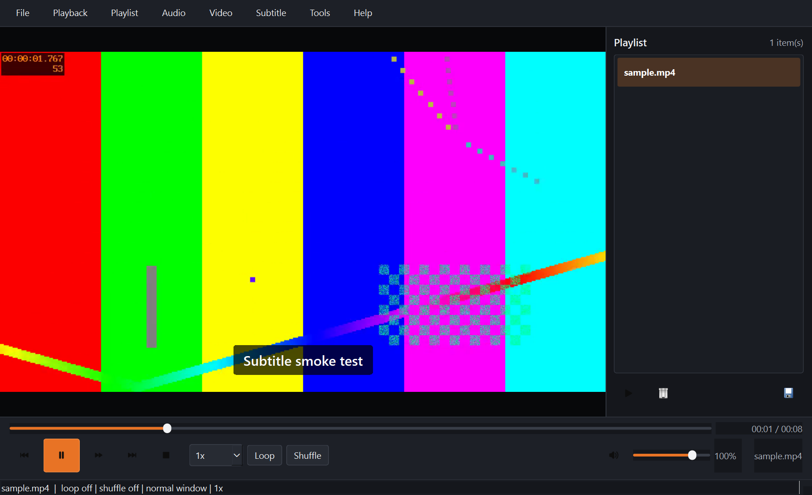

# FFmpeg Qt Player 2.0

这是一个把 `FFmpegExample-main` 的单文件播放内核，与 `vlc-re` 中已经实现的桌面播放器产品功能合并后得到的完整 Qt 播放器工程。

播放内核完全使用 **FFmpeg + Qt**：

- FFmpeg `libavformat` 负责解封装、网络协议和选流。
- FFmpeg `libavcodec` 负责音频、视频解码。
- FFmpeg `libswresample` 负责 PCM 重采样和声道转换。
- FFmpeg `libswscale` 负责 YUV/其他像素格式到 `BGRA` 的转换。
- Qt `QAudioSink` 负责 PCM 音频输出。
- Qt Widgets 与 `QPainter` 负责产品界面、字幕叠加和软件渲染回退。
- Qt RHI、`QRhiWidget` 与 D3D11 VideoProcessor 负责 Windows 硬件帧的无 CPU 回读呈现。

工程不链接 `libVLC`，也不要求系统中安装 VLC。



## 先看这里

- 功能对照、构建方法和快捷键：[README-FULL.md](README-FULL.md)
- 使用的语言、框架、FFmpeg 库和 Qt 模块：[TECH-STACK.md](TECH-STACK.md)
- 结构导图、代码详解与接口函数索引：[PROJECT-MAP.md](PROJECT-MAP.md)
- 逐模块、逐流程、逐线程的完整源码详解：[CODE-WALKTHROUGH.md](CODE-WALKTHROUGH.md)
- 面试讲解、高频追问与简历写法：[INTERVIEW-GUIDE.md](INTERVIEW-GUIDE.md)
- 依赖和再分发说明：[THIRD-PARTY-NOTICES.md](THIRD-PARTY-NOTICES.md)

## 功能对照

| 功能 | 原 FFmpegExample | vlc-re 产品层 | 当前实现 |
| --- | --- | --- | --- |
| FFmpeg 解封装与解码 | 有 | 由 libVLC 内部完成 | 有，FFmpeg API 独立实现 |
| 视频显示 | 有基础 Qt 显示 | 由 libVLC 子窗口输出 | Qt `VideoCanvas` 绘制 |
| 播放、暂停、停止 | 有 | 有 | 有 |
| 播放进度与跳转 | 有基础能力 | 有 | 有，按毫秒定位 |
| 上一项、下一项 | 不完整 | 有 | 有 |
| 播放列表 | 无 | 有 | 有 |
| 文件、文件夹、URL | 无或很少 | 有 | 有 |
| 网络读取超时与自动重连 | 无 | 无 | 有，HTTP 可配置超时、退避和有限重试 |
| 缓存水位与重缓冲状态 | 无 | 部分 | 有，包队列限制字节/时长，区分起播与恢复水位 |
| 弱网状态反馈 | 无 | 部分 | 有，`Buffering` / `Stalled` / `Reconnecting` 状态与指标 |
| M3U/M3U8/PLS 导入 | 无 | 有 | 有 |
| M3U 导出 | 无 | 有 | 有 |
| 循环、随机 | 无 | 有 | 有 |
| 倍速 0.25x 至 4x | 无 | 有 | 有 |
| 音量、静音、滚轮音量 | 无 | 有 | 有 |
| 单帧步进 | 有原始实验逻辑 | 无 | 有 |
| 后退单帧 | 无 | 无 | 有，暂停时按帧率回退 |
| 跳转到指定时间 | 无 | 有 | 有，支持 `SS`、`MM:SS`、`HH:MM:SS` |
| A-B 循环 | 无 | 有 | 有，面板内反复播放指定区间 |
| 单文件续播 | 无 | 有 | 有，按文件记录位置并自动续播 |
| 全屏 | 无 | 有 | 有 |
| 窗口置顶 | 无 | 有 | 有 |
| 迷你播放器 | 无 | 无 | 有，小窗置顶并隐藏菜单和列表 |
| 深色/浅色主题 | 无 | 有 | 有，运行时切换并记住选择 |
| 快捷键总览 | 无 | 无 | 有，`F1` 打开 |
| 截图 | 无 | 有 | 有 |
| SRT/VTT/ASS/SSA 外挂字幕 | 无 | 有 | 有 |
| 自动加载同名外挂字幕 | 无 | 有 | 有 |
| 内嵌字幕轨与切换 | 无 | 有 | 有，支持文本类内嵌轨并在当前位置热切换 |
| 多音轨切换 | 无 | 有 | 有，在当前位置热切换且不重开媒体 |
| 字幕延迟、字号、位置 | 无 | 有 | 有 |
| 字幕字体、颜色、描边、背景 | 无 | 无 | 有，可视化设置并持久化 |
| 复制当前字幕 | 无 | 无 | 有 |
| 播放列表搜索/排序/去重 | 无 | 部分 | 有 |
| 媒体信息面板 | 无 | 有 | 有，可复制完整文本 |
| 播放诊断导出 | 无 | 无 | 有，包含状态、性能、队列、网络和事件日志 |
| 章节点导航 | 无 | 有 | 有，菜单选择及上一章/下一章快捷键 |
| AI 语音与画面识别 | 无 | 无 | 有，OpenAI 兼容接口，实时转写并滚动生成核心内容 |
| 截图包含字幕 | 无 | 有 | 可选 |
| 画面比例模式 | 无 | 有 | 有（适应、填充、拉伸、16:9、4:3、原始） |
| 全屏浮动控制条 | 无 | 有 | 有，2.5 秒后自动隐藏 |
| 视频旋转元数据 | 无 | 无 | 有，按 display matrix 旋转 |
| 手动画面旋转 | 无 | 部分 | 有，顺时针/逆时针 90° 及重置 |
| 睡眠定时器 | 无 | 有 | 有，15/30/45/60/90 分钟或自定义 |
| 暂停时跳转预览 | 无 | 有 | 有，暂停状态下跳转立即显示目标帧 |
| 播放列表拖动排序 | 无 | 有 | 有 |
| 启动恢复上次播放 | 无 | 有 | 有，恢复播放列表、当前项和位置并暂停 |
| 最近文件 | 无 | 有 | 有 |
| 拖放媒体 | 无 | 有 | 有 |
| 视频右键菜单 | 无 | 有 | 有 |
| 双击视频进入全屏 | 无 | 有 | 有 |
| 设置持久化 | 无 | 有 | 有 |
| 命令行打开媒体 | 无 | 有 | 有 |
| 中英文界面 | 无 | 无 | 有，运行时切换并记住选择 |
| 依赖 libVLC | 否 | 是 | 否 |

这里的“移植”指移植 `vlc-re` 实际存在的桌面产品功能。不是复制 VLC 官方全部功能，也没有复制 VLC 的插件体系。

## 环境要求

已验证环境：

- Windows 10/11 x64
- Visual Studio 2022，MSVC x64
- CMake 3.24 或更高
- Ninja
- Qt 6.5 或更高，验证版本为 6.11.1 MSVC 2022 x64
- FFmpeg 3.4 x64 SDK，工程内已经附带

默认构建脚本会自动查找：

- Qt：`C:\Qt\6.11.1\msvc2022_64`、`C:\Qt\6.10.0\msvc2022_64`、`C:\Qt\6.9.3\msvc2022_64`
- Visual Studio：`D:\vs2022` 或标准安装目录
- CMake：`D:\bin\cmake.exe`、VS 自带 CMake，或 `PATH` 中的 `cmake.exe`
- Ninja：VS 自带 Ninja，或 `PATH` 中的 `ninja.exe`

## 构建

在工程根目录打开 PowerShell：

```powershell
.\build.ps1 -Configuration Debug
.\build.ps1 -Configuration Release
```

完全重新配置并构建：

```powershell
.\build.ps1 -Configuration Release -Clean
```

Qt、Visual Studio、CMake 安装在非默认位置时：

```powershell
.\build.ps1 `
  -Configuration Release `
  -QtRoot "D:\Qt\6.11.1\msvc2022_64" `
  -VsDevCmd "D:\vs2022\Common7\Tools\VsDevCmd.bat" `
  -CMake "D:\bin\cmake.exe" `
  -Ninja "D:\vs2022\Common7\IDE\CommonExtensions\Microsoft\CMake\Ninja\ninja.exe"
```

构建产物：

```text
build\Debug\FFmpegQtPlayer.exe
build\Release\FFmpegQtPlayer.exe
```

Debug 构建会同时生成测试程序。运行播放器核心测试和真实媒体 smoke test：

```powershell
ctest --test-dir build\Debug --output-on-failure
```

Debug 会注册六个测试：`PlaybackCoreTests`、`CrashReporterSmoke`、`PlayerSmoke`、`NetworkRecoverySmoke`、`TrackSwitchSmoke` 和 `GpuRenderSmoke`。`PlayerSmoke` 会打开 `sample.mp4`，切换到 2x，执行前后跳转和连续 seek，并验证诊断导出内容；网络测试会通过本地 HTTP Range 服务主动截断响应；切轨测试使用两条 AAC 音轨和两条 `mov_text` 字幕轨的固定夹具；GPU 测试验证 `d3d11va-zero-copy -> D3D11 VideoProcessor -> QRhiWidget` 链路、非空画面像素和零 CPU 回读。

可重复性能基准：

```powershell
.\build\Debug\PlayerBench.exe .\sample.mp4 --seeks 8
```

`PlayerBench` 输出首帧延迟、seek p50/p95、平均 CPU、峰值工作集、硬解后端、丢帧、A/V drift、缓存水位、重连次数和帧池命中的单行 JSON。正式报告应固定机器和样本重复运行，并保留原始输出。

CMake 的 POST_BUILD 阶段会完成：

1. 复制 FFmpeg 3.4 主 DLL。
2. 复制这个 MinGW 版 FFmpeg 所需的压缩、iconv 和 pthread DLL。
3. 从 Qt 安装目录复制 `qtbase_zh_CN.qm` 到输出目录的 `translations/`，供中文界面翻译标准对话框。
4. 调用 `windeployqt` 部署 Qt 运行库与插件。

## 运行

不传媒体：

```powershell
.\run.ps1 -Configuration Release
```

启动并打开媒体：

```powershell
.\run.ps1 -Configuration Release -MediaPath ".\sample.mp4"
```

也可以直接运行：

```powershell
.\build\Release\FFmpegQtPlayer.exe ".\sample.mp4"
```

## 快捷键

| 操作 | 快捷键 |
| --- | --- |
| 打开文件 | `Ctrl+O` |
| 添加文件 | `Ctrl+Shift+O` |
| 打开网络流 | `Ctrl+L` |
| 保存播放列表 | `Ctrl+S` |
| 播放/暂停 | `Space` |
| 停止 | `S` |
| 上一项/下一项 | `P` / `N` |
| 单帧步进 | `E` |
| 后退单帧 | `Ctrl+Left` |
| 跳转到指定时间 | `Ctrl+G` |
| 上一章 / 下一章 | `Ctrl+PageUp` / `Ctrl+PageDown` |
| AI 语音与画面识别 | `Ctrl+Shift+I` |
| 设置 A 点 / B 点 | `Ctrl+Shift+A` / `Ctrl+Shift+B` |
| 清除 A-B 循环 | `Ctrl+Shift+X` |
| 前进/后退 5 秒 | `Right` / `Left` |
| 降低/提高倍速 | `[` / `]` |
| 音量加减 | `Up` / `Down` |
| 静音 | `M` |
| 截图 | `Ctrl+P` |
| 顺时针 / 逆时针旋转 90° | `Ctrl+R` / `Ctrl+Shift+R` |
| 截图包含字幕 | Subtitle 菜单开关 |
| 加载字幕 | `Ctrl+Shift+T` |
| 字幕样式 | `Ctrl+Shift+S` |
| 复制当前字幕 | `Ctrl+Shift+C` |
| 显示/隐藏字幕 | `Ctrl+H` |
| 字幕延迟 -100 / +100 ms | `Ctrl+Alt+Left` / `Ctrl+Alt+Right` |
| 搜索播放列表 | `Ctrl+F` |
| 播放列表显示/隐藏 | `Ctrl+J` |
| 迷你播放器 | `Ctrl+Shift+M` |
| 全屏 | `F11` 或 `F` |
| 退出全屏 / 迷你模式 | `Esc` |
| 快捷键总览 | `F1` |
| 退出程序 | `Ctrl+Q` |

播放列表操作：

- 双击或按 `Enter` 播放选中项。
- 按 `Delete` 删除选中项。
- 顶部搜索框按标题或路径实时过滤，`Ctrl+F` 聚焦搜索。
- `Playlist > Sort Playlist` 可按标题或路径排序，`Remove Duplicates` 去除重复条目。
- 拖动列表项可调整顺序，当前播放项会跟随。
- 右键可删除或清空播放列表。
- 视频区域滚轮每档调整 5% 音量。
- 双击视频区域进入或退出全屏。
- 控制栏的 `⏪` / `⏩` 是快退/快进 5 秒，播放中按下不会暂停。
- 点击进度条任意位置会立即跳转，按住可连续拖动预览。
- 视频区域右键菜单提供播放、单帧、停止、跳转、截图、字幕和全屏操作。

播放与界面补充：

- `Ctrl+G` 输入时间跳转，接受 `90`、`01:30`、`00:01:30` 等写法。
- `Playback > A-B Repeat` 设置 A/B 点后只在区间内循环；清除后恢复普通播放。
- 暂停时 `Ctrl+Left` 按当前帧率后退一帧，`E` 前进一帧。
- 关闭前正在播放的文件会记录位置，下次打开同一文件自动续播；距片头 5 秒内或距片尾 3 秒内不记录。
- `Tools > Mini Player`（`Ctrl+Shift+M`）进入 560×340 的置顶小窗，隐藏菜单、状态栏和播放列表；再按 `Ctrl+Shift+M` 或 `Esc` 恢复。
- `Tools > Light Theme` 在深色与浅色主题间切换，选择会保存。
- `Help > Keyboard Shortcuts`（`F1`）列出全部快捷键。

## 界面语言

菜单栏 `Language`（语言）提供 `English` 和 `简体中文` 两个选项，点击即时切换，不需要重启：

- 菜单、工具栏提示、按钮文字、对话框、错误信息、播放器状态和画布提示都会跟随切换。
- 标准对话框按钮（确定 / 取消等）使用 Qt 自带的 `qtbase_zh_CN.qm` 翻译。
- 语言选择写入 `settings.ini` 的 `ui/language` 键，下次启动沿用。
- 首次启动没有保存过选择时，跟随系统语言：中文系统默认中文，其它默认英文。

实现上以英文原文为键，内置英中词典由自定义 `QTranslator` 提供；切换时广播 `QEvent::LanguageChange`，主窗口重新应用所有静态文本，动态文本由已安装的翻译器自动翻译。

## AI 语音与画面识别

打开 `Tools > AI Speech and Video Recognition...`（`Ctrl+Shift+I`）后，可以配置一个 OpenAI 兼容服务，并在播放当前媒体时持续生成：

- 实时语音转写：按 5-30 秒切分解码后的 PCM，在客户端转换成 16 kHz 单声道 WAV 后提交转写。
- 视频画面理解：按 5-120 秒间隔抽取当前画面，缩放为最长边不超过 960 像素的 JPEG 后提交视觉模型。
- 实时核心内容：把滚动语音转写、画面记录和上一版核心内容一起交给文本模型，持续更新 3-6 条核心要点。

识别请求全部通过 Qt Network 异步执行，不阻塞视频解码和播放。暂停、跳转、切换媒体或停止识别时，会提交或丢弃剩余音频缓冲，并重置画面采样位置，避免不同时间点的数据混在一起。

### 接口格式

基础地址应指向 API 的版本根路径，播放器会调用：

```text
POST <baseUrl>/audio/transcriptions
POST <baseUrl>/chat/completions
```

例如基础地址填写 `https://api.openai.com/v1` 或本地服务地址 `http://127.0.0.1:8000/v1`。语音请求使用 multipart form data，画面和核心内容请求使用 OpenAI Chat Completions JSON 格式。鉴权头为：

```text
Authorization: Bearer <API Key>
```

本地无鉴权服务可以把 API Key 留空。服务不提供 `/audio/transcriptions` 时，可以关闭“语音识别”，仅使用视觉与核心内容功能。

### 默认配置

| 配置 | 默认值 | 说明 |
| --- | --- | --- |
| 语音转写模型 | `whisper-1` | 需由所配置服务支持 |
| 文本 / 核心内容模型 | `gpt-4o-mini` | 用于滚动摘要 |
| 画面识别模型 | `gpt-4o-mini` | 需要支持图片输入 |
| 音频分块 | 12 秒 | 可选 5-30 秒 |
| 画面间隔 | 20 秒 | 可选 5-120 秒 |
| 音频语言 | 自动检测 | 也可指定中文或英文 |
| 输出语言 | 简体中文 | 可切换为英文 |

如果没有保存过对应设置，启动时会读取以下环境变量作为初始值：

```powershell
$env:OPENAI_BASE_URL = "https://api.openai.com/v1"
$env:OPENAI_API_KEY = "sk-..."
.\build\Release\FFmpegQtPlayer.exe .\sample.mp4
```

也可以在本地运行 OpenAI 兼容服务，然后在界面中填写 `http://127.0.0.1:8000/v1`。服务端必须按上面的路径和响应格式实现对应接口。

### 隐私、费用与限制

- 开启识别后，音频片段和抽样 JPEG 画面会离开本机并发送到所配置的服务，不再只是播放器本地处理。
- 每次语音、画面和核心内容请求都可能产生 API 费用；缩短音频分块或画面间隔会增加请求次数。
- API Key 会保存在 `settings.ini` 的 `ai/apiKey` 中，目前是明文存储，不应在共享电脑上保存生产密钥。
- 当前实现是分块准实时识别，不是云端 WebSocket 双向流；转写和核心内容通常会有数秒到数十秒延迟。
- 画面识别只分析定时抽取的单帧，不会理解帧间运动；核心内容质量依赖模型能力、音频清晰度和画面信息量。
- 当前不保存识别历史。切换媒体时会清空当前转写和核心内容，退出程序后也不会恢复。

## 字幕

外挂字幕支持：

- SRT
- WebVTT
- ASS
- SSA

打开媒体时会自动查找同目录、同文件名的 `.srt`、`.ass`、`.ssa`、`.vtt`。也可以通过菜单手动加载。

内嵌字幕轨：

- 枚举媒体中的文本类字幕流（例如 MP4 `mov_text`、MKV `subrip`/`ass`、WebVTT 等）。
- 在 `Subtitle > Embedded Subtitle Track` 中选择 `None`、`Automatic` 或具体轨道。
- 切换轨道时只重建目标字幕解码器并清空对应 cue，不重新打开媒体；视频和音频播放位置保持不变。

字幕样式与同步：

- `Subtitle > Subtitle Delay` 按 100 ms 调整延迟。
- `Subtitle Size` 和 `Subtitle Position` 调整字号与距底部的位置。
- `Subtitle > Subtitle Style...`（`Ctrl+Shift+S`）可设置字体、文字颜色、描边颜色与宽度、背景颜色与不透明度，修改时画布实时预览，确定后保存。
- `Subtitle > Copy Current Subtitle`（`Ctrl+Shift+C`）把当前显示的字幕文本复制到剪贴板。
- `Ctrl+H` 显示或隐藏字幕。
- `Include Subtitles in Snapshot` 决定截图是否包含字幕。

字幕显示在 `VideoCanvas` 内部，属于视频画布叠加层，不改变竖屏或横屏视频的等比显示比例。ASS/SSA 只保留文本内容，不渲染完整特效和定位。

## 设置文件

设置保存在：

```text
%APPDATA%\FFmpegQtPlayer\FFmpeg Qt Player\settings.ini
```

保存内容包括：

- 音量、静音、播放速度
- 循环、随机
- 播放列表显示状态
- 窗口置顶
- 窗口几何尺寸
- 画面比例模式
- 字幕显示、延迟、字号、位置
- 字幕字体、文字颜色、描边颜色与宽度、背景颜色与不透明度
- 截图是否包含字幕
- 深色/浅色主题（`ui/theme`，`dark` 或 `light`）
- 最近文件（最多 12 项）
- 界面语言（`ui/language`，`en` 或 `zh`）
- AI 服务地址、模型、语言、分块与抽样间隔（`ai/*`）
- AI API Key（`ai/apiKey`，明文保存）
- 单文件续播位置（`resume/items`，最多 100 条）
- 上次的播放列表、当前项和播放位置（下次启动时恢复并保持暂停）

## 工程结构

```text
FFmpegQtPlayer/
├─ main.cpp                 # QApplication 和主窗口入口
├─ MainWindow.h/.cpp        # 界面、播放列表、菜单、字幕、设置
├─ FFmpegPlayer.h/.cpp      # FFmpeg 解封装、软/硬解、音频输出、同步
├─ PlaybackClock.h/.cpp     # 墙钟/音频主时钟与自适应阈值
├─ PacketQueue.h/.cpp       # 有界 packet 队列与背压
├─ StreamingPolicy.h/.cpp   # 网络识别、超时、重连退避和缓存水位
├─ VideoFramePool.h/.cpp    # 三槽 QImage 帧池与跨线程存活检测
├─ RhiVideoSurface.h/.cpp   # QRhiWidget、D3D11 VideoProcessor 与零拷贝呈现
├─ D3d11ContextSync.h       # 解码上下文、Qt RHI 和驱动多线程保护
├─ CrashReporter.h/.cpp     # 未处理异常捕获和崩溃转储
├─ AiRecognitionService.h/.cpp # 语音转写、画面理解、核心内容滚动摘要
├─ AiContentDialog.h/.cpp   # AI 配置、实时转写与核心内容界面
├─ VideoCanvas.h/.cpp       # 视频等比绘制、字幕叠加、拖放和滚轮
├─ VideoOverlay.h/.cpp      # 字幕、OSD 和 GPU 画面上的透明叠加层
├─ HlsPlaylist.h/.cpp       # HLS master playlist 与变体解析
├─ SubtitleTrack.h/.cpp     # SRT/VTT/ASS/SSA 解析
├─ Language.h/.cpp          # 中英文词典、QTranslator 和应用
├─ CMakeLists.txt           # 主构建入口
├─ FFmpegQtPlayer.pro       # qmake 备用入口
├─ build.ps1                # 自动查找 Qt/VS/CMake/Ninja
├─ run.ps1                  # 构建并启动
├─ ffmpeg3.4-x64-debug/     # 工程内附带的 FFmpeg SDK
├─ sample.mp4               # 8 秒测试视频
├─ tests/                   # 单元、崩溃、播放、网络、切轨、GPU smoke 与性能基准
│  └─ fixtures/track-switch.mp4 # 两音轨、两字幕轨测试夹具
├─ README.md
├─ TECH-STACK.md            # 技术栈和模块说明
├─ CODE-WALKTHROUGH.md
├─ INTERVIEW-GUIDE.md       # 面试讲解、Q&A、简历写法
└─ THIRD-PARTY-NOTICES.md
```

## 设计边界

- 同一时刻只解码一条视频流；音轨和字幕轨可以枚举，并在当前位置热切换目标 decoder，不重新打开媒体。
- 内嵌字幕在解封装线程中增量解码，只支持 FFmpeg 能还原成文本的字幕格式；PGS/VobSub 等图形字幕不会显示。
- 视频正常路径使用 FFmpeg D3D11VA 硬解，并把硬件帧直接交给 Qt RHI 的 D3D11 设备；D3D11 VideoProcessor 在 GPU 上完成 NV12/P010 到 BGRA 的转换，`QRhiWidget` 采样纹理显示，不需要 `av_hwframe_transfer_data` 回读。
- GPU 设备、VideoProcessor 或 RHI 初始化失败时，播放器会停止提交新的 GPU 帧并回退到硬件帧回读或软件解码；诊断指标中的 `hardwareReadbacks` 可区分两条路径。
- FFmpeg 解码和 Qt RHI 共用 D3D11 即时上下文，因此 FFmpeg 的 `lock/unlock` 回调、`QRhiWidget::paintEvent` 和 `ID3D11Multithread` 使用同一同步边界，避免解码线程与驱动提交并发造成卡死。
- 有音频时使用 `QAudioSink::processedUSecs()` 驱动主时钟，视频跟随音频时钟；无声媒体回退到 `steady_clock`。视频丢帧阈值根据帧率和近期抖动动态调整。
- 0.25x 至 4x 倍速使用 FFmpeg `atempo` 时间伸缩保持音高。超过单级 `atempo` 范围时串联两级，重采样只负责采样率/声道/格式转换。
- 外挂字幕只解析纯文本，不渲染 ASS 的完整特效、定位和图形；内嵌 ASS 同样只保留文本。
- 视频旋转依据 FFmpeg display matrix 一次性缓存旋转后的图像，圆形以外的画面不额外裁剪。
- 网络流取决于编译进 FFmpeg 的协议和系统网络环境；HTTP 读取默认启用 5 秒 `rw_timeout`、有限次指数退避重连和可中断等待。
- 缓存由 packet 数量、字节上限和缓存时长共同约束；起播与重新缓冲使用不同水位，避免网络短暂停顿立即卡断，也避免缓存无限增长。
- 视频帧池固定三个槽位；GUI 仍持有的 `QImage` 不会被覆盖，池满时回退为独立分配。
- FFmpeg 3.4 较旧，工程保留它是为了与原始示例 SDK 保持 ABI 和依赖一致；该版本没有 TTML 等较新的字幕编码。
- 零拷贝链路当前只覆盖 Windows D3D11；HDR 静态/动态元数据、HDR tone mapping、4K 长稳和真实 RTSP/HLS 弱网仍属于后续验证项。
- 没有实现 VLC 的插件系统、均衡器、视频滤镜、录像、投屏等全部官方功能。

## 验证记录

已完成的自动/半自动验证：

- Debug 和 Release 均通过 CMake + Ninja + MSVC 构建。
- 2026-11-12 的 Debug `ctest --test-dir build\Debug --output-on-failure` 结果为 6/6 通过，覆盖时钟、暂停恢复、倍率、队列背压/abort、崩溃捕获、真实播放、网络断线恢复、音轨/字幕轨热切换、诊断导出和 D3D11 零拷贝渲染。
- 网络恢复测试在本地 HTTP Range 服务中主动截断第 4 个响应，结果为 `requests=6 reconnects=3 frames=8 state=3`，最终状态为 `Playing`，证明传输层重连后播放链路可以继续。
- 热切轨测试结果为 `audio=2 subtitle=4 openSerial=1 frames=17 state=3`。切换两条音轨和字幕轨后，媒体打开序号仍为 1，视频继续出帧。
- `PlayerSmoke` 使用软件解码验证时间戳、seek 和诊断导出，不把硬解时序混入快速回归；GPU 路径由 `GpuRenderSmoke` 单独验证。
- `GpuRenderSmoke` 连续 5 次通过，典型结果为 `hardware=d3d11va-zero-copy render=d3d11-rhi-zero-copy submitted=6 rendered=5 readbacks=0 state=3`，同时对截图做非空亮度范围检查。
- 2026-11-12 使用 `PlayerBench --seeks 8` 连续运行 20 次，20/20 成功，0 次视频/音频包丢弃；首帧 34-54 ms，seek p50 24-76 ms，seek p95 173-361 ms，稳定窗口 A/V drift 0-10 ms，平均 CPU 1.9%-3.0%，峰值工作集 120.5-122.0 MB，媒体打开序号始终为 1。原始 JSON 保存在 `D:\codex\2026-11-12\rna\work\bench-p1-run01.json` 至 `bench-p1-run20.json`，汇总在 `bench-p1-runs-summary.json`。
- 帧池在 20 次基准中累计命中 260 次、未命中 60 次；未命中来自每次进程启动、尺寸变化或仍被 GUI 持有的槽位，符合三槽存活保护策略。
- Release 构建成功；修复 D3D11 上下文并发后，用 `sample.mp4` 连续运行 40 秒，进程始终为 `Responding=True`，窗口标题为 `sample.mp4 - FFmpeg Qt 播放器`，CPU 时间随播放持续增长。
- `sample.mp4` 可解出 H.264/MPEG-4 视频和 AAC 音频。
- 首帧显示正常。
- 暂停、逐帧、跳转、2 倍速、音量、静音、恢复和停止通过冒烟测试。
- 界面级验证：在 30 秒测试片上拖动进度条到 55% 后位置落到 17.4 秒并继续播放，`⏩` 按钮前进约 5 秒且不暂停，2 倍速下 1.6 秒墙钟推进 3.2 秒媒体时间。
- 无窗口内核测试：播放中跳转、末尾自然结束、结束后拖动进度条重开为暂停状态、暂停态跳转均符合预期。
- 逐帧测试确认位置向前推进一帧，状态保持 `Paused`。
- 4 秒跳转位置落在 `4000 ms`；暂停时跳转会立即显示目标位置的预览帧，并丢弃跳转前的旧帧。
- 含两条 AAC 音轨和一条内嵌 `mov_text` 字幕轨的 MP4 可被识别，字幕按时间正确显示，音轨菜单可枚举两条轨道。
- 带 `rotate` 元数据的 MP4 显示方向与 `ffmpeg` 自动旋转结果一致。
- 内嵌字幕在暂停、继续和跳转后保持正确文本；跳转后保留已解码字幕并去重。
- 全屏时菜单、状态栏和播放列表面板隐藏，底部浮动控制条在鼠标移动时出现、2.5 秒后自动隐藏；退出全屏后原布局恢复；从最大化状态进出全屏会回到最大化，窗口化进出会回到原窗口几何。
- 缩放/全屏路径专项验证：全屏 2560×1600 下 16:9 画面上下各留 80 px 对称黑边；1480 宽窗口下画面水平居中且左右黑边对称；以 30 ms 间隔连续 7 次改尺寸后立即截图与稳定后截图边界一致，无残影；窗口可缩到 640×400 逻辑像素，控制栏按宽度依次隐藏倍速/循环/音量并省略媒体名。
- 播放列表可拖动排序，当前播放项索引跟随；`settings.ini` 会保存播放列表、当前项和位置，重启后以暂停状态恢复。
- 画面比例模式、状态栏进度条、音量 OSD 和字幕字号/位置调整已接入。
- 默认窗口尺寸会按当前屏幕可用区域收缩并居中，避免高 DPI 小屏上底部控制条落到屏幕外。
- 纯音频 WAV 可播放并推进位置，视频标记为 false。
- 包含视频和纯音频两项的 M3U 可导入，列表数量为 2。
- 同目录 `sample.srt` 自动加载并在视频画面上正确显示。
- 界面级验证：播放 8 秒 `sample.mp4` 时在 `English` / `简体中文` 之间多次切换，窗口标题、菜单栏、播放按钮提示、循环/随机按钮、状态栏信息与 `QMessageBox` 的确定/取消按钮均正确切换；语言写入 `settings.ini`，重启后恢复中文界面。
- 词典覆盖率检查：261 条词典条目覆盖源码中全部 256 条 `tr()` 原文，无遗漏。
- 新功能界面级验证（Debug 连续 3 次、Release 连续 2 次全部通过）：播放列表去重后 3 项变 2 项、按标题排序、搜索过滤与 `1 / 2 item(s)` 计数；深色/浅色样式即时切换；迷你播放器隐藏菜单/列表、置顶、`Esc` 恢复；后退单帧位置回退；`Ctrl+G` 跳转到 10 秒；A-B 区间播放后自动回跳并清除；无字幕时复制提示；字幕样式对话框含字体/描边/背景控件并保存；媒体信息含来源与码率且可复制；快捷键窗口列出新增按键；中英文新增文本全部翻译；关闭后 `resume/items` 保存位置，重启打开同一文件从保存位置续播；主题与字幕样式重启后恢复。
- AI 模块通过本地 OpenAI 兼容假服务端到端验证：multipart 语音请求、JPEG 画面请求和滚动核心内容请求均成功，结果为 `transcript=ok vision=ok summary=ok`。
- AI 鉴权失败验证：服务返回 HTTP 401 后，语音、画面、摘要请求全部中止并触发停止状态，结果为 `auth-stop=ok`。
- AI 新增菜单、按钮、设置项、隐私提示和动态格式文本通过中英文词典覆盖检查。
- 重新构建后的 Release 程序可用 `sample.mp4` 启动并保持响应。
- 关闭窗口时先停止播放线程，避免解码线程访问已销毁的画布。

## 许可证

本工程使用动态链接的 FFmpeg 3.4，该 SDK 自带的 `ffmpeg.exe -L` 输出声明为 LGPL 2.1 或更高版本。Qt 按其商业许可证或 LGPL/GPL 条款使用。详见 [THIRD-PARTY-NOTICES.md](THIRD-PARTY-NOTICES.md)。
