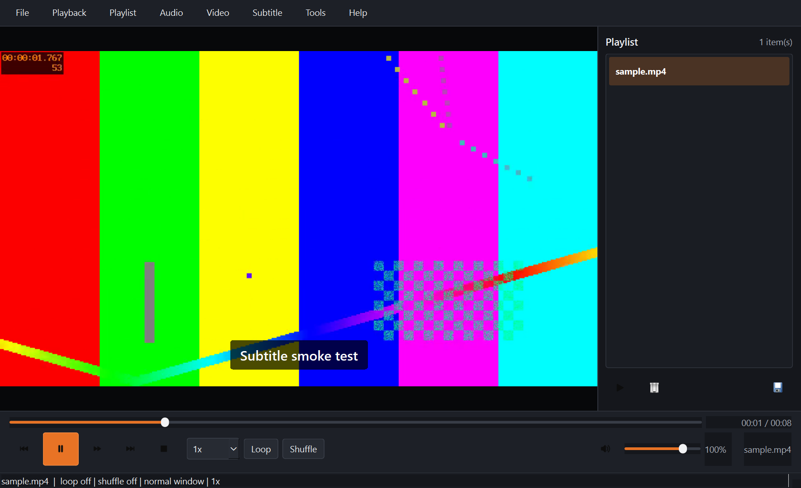

# FFmpegQtPlayer

一个使用 **C++17 + Qt 6 + FFmpeg** 实现的 Windows 桌面音视频播放器。

播放器不依赖 `QMediaPlayer`，也不链接 libVLC。FFmpeg 负责解封装和解码，Qt 负责界面、音频设备与 GPU 呈现，播放器自身负责线程调度、缓存、时钟、同步、seek、网络恢复和状态管理。




## 项目简介

这个项目从一个基础 FFmpeg 解码示例出发，补全为一个可以实际操作的桌面播放器。除了播放本地文件，它还覆盖网络流、字幕、播放列表、播放历史、热切换轨道、弱网恢复、D3D11VA 硬件解码和 Qt RHI 零拷贝呈现。

核心链路可以概括为：

```text
文件 / URL
   ↓
avformat_open_input + av_read_frame
   ↓
Audio PacketQueue ──→ 音频解码 ──→ swr_convert ──→ QAudioSink
   │
   └─ Video PacketQueue ──→ D3D11VA / 软件解码
                              ├─ D3D11 VideoProcessor + QRhiWidget
                              └─ sws_scale + QImage + QPainter
   ↓
AudioClock / WallClock → 视频等待、丢帧与音画同步
```

## 核心能力

- **本地与网络播放**：文件、文件夹、URL、HTTP/HTTPS、RTSP、RTMP 等 FFmpeg 支持的输入。
- **自主播放内核**：解封装、选流、解码、PCM 重采样、视频转换和状态机均由项目代码管理。
- **三线程模型**：控制线程、音频线程和视频线程解耦，音频/视频使用有界 packet 队列形成背压。
- **音频主时钟**：有音频时使用 `QAudioSink::processedUSecs()` 驱动媒体时间，视频跟随音频时钟；无音频时回退墙钟。
- **精确 seek**：`av_seek_frame`、decoder flush、队列清理、PTS 目标过滤和 seek 世代号共同处理并发 seek。
- **硬件渲染**：Windows 下使用 D3D11VA 解码，D3D11 VideoProcessor 转换后交给 Qt RHI；渲染失败时回退软件路径。
- **保持音高变速**：通过 FFmpeg `atempo` 支持 `0.25x` 到 `4x` 播放。
- **字幕与轨道**：SRT、WebVTT、ASS/SSA 文本字幕，内嵌字幕轨，多音轨热切换。
- **网络恢复**：读超时、有限重试、指数退避、缓冲水位和 `Buffering` / `Stalled` / `Reconnecting` 状态。
- **桌面体验**：播放列表、最近文件、续播、深色/浅色主题、全屏、迷你播放器、快捷键、中英文界面。

## 技术亮点

### 播放线程与队列

```text
GUI 线程
  └─ MainWindow / VideoCanvas / 用户操作

controlThread
  └─ run() → readPackets() → av_read_frame → seek / buffering / reconnect

audioThread
  └─ audioLoop() → decode → atempo → swresample → QAudioSink

videoThread
  └─ videoLoop() → decode → clock wait → RHI render / QImage fallback
```

音频队列和视频队列同时限制 packet 数量与字节数。这样网络抖动或视频渲染短暂变慢时，不会让内存无限增长，也不会让控制线程完全失去响应。

### 音画同步

有音频时，播放器的媒体时间来自音频设备已经播放的时长，而不是简单使用 `QElapsedTimer`。视频线程将帧 PTS 与音频时钟比较，根据帧间隔和近期抖动动态计算等待与丢帧阈值，避免落后画面突然快放补帧。

### Windows GPU 路径

正常路径：

```text
FFmpeg D3D11VA
  → D3D11 硬件纹理
  → D3D11 VideoProcessor（NV12/P010 → BGRA）
  → Qt RHI / QRhiWidget
```

硬件上下文由 `ID3D11Multithread`、FFmpeg lock 回调和 RHI 提交边界共同保护。VideoProcessor、RHI 或设备初始化失败时，播放器不会直接退出，而是回退到硬件帧回读或软件解码。

## 快速开始

### 环境要求

- Windows 10/11 x64
- Visual Studio 2022，安装“使用 C++ 的桌面开发”
- CMake 3.24 或更高版本
- Ninja
- Qt 6.7 或更高版本，MSVC 2022 x64
- 工程内附带的 FFmpeg 3.4 x64 SDK

### 构建

在项目根目录打开 PowerShell：

```powershell
.\build.ps1 -Configuration Debug
.\build.ps1 -Configuration Release
```

如果 Qt 不在默认目录，可以显式传入路径：

```powershell
.\build.ps1 `
  -Configuration Release `
  -QtRoot "C:\Qt\6.11.1\msvc2022_64"
```

主要产物：

```text
build\Debug\FFmpegQtPlayer.exe
build\Release\FFmpegQtPlayer.exe
```

### 运行

```powershell
.\run.ps1 -Configuration Release
.\run.ps1 -Configuration Release -MediaPath ".\sample.mp4"
```

也可以直接启动可执行文件：

```powershell
.\build\Release\FFmpegQtPlayer.exe ".\sample.mp4"
```

### 测试

Debug 配置会生成完整测试目标：

```powershell
ctest --test-dir .\build\Debug --output-on-failure
```

当前验证结果：

```text
PlaybackCoreTests       Passed
CrashReporterSmoke      Passed
PlayerSmoke             Passed
NetworkRecoverySmoke    Passed
TrackSwitchSmoke        Passed
GpuRenderSmoke           Passed
```

共 `6/6` 通过。GPU 测试覆盖 `D3D11VA → D3D11 VideoProcessor → QRhiWidget` 链路、非空画面像素和零 CPU 回读；网络测试覆盖连接中断后的恢复。

性能基准：

```powershell
.\build\Debug\PlayerBench.exe .\sample.mp4 --seeks 8
```

## 工程结构

```text
.
├─ main.cpp                    # 程序入口
├─ MainWindow.*                # 主窗口、菜单、播放列表和设置
├─ FFmpegPlayer.*              # 解封装、解码、队列、时钟、seek 和网络状态
├─ PlaybackClock.*             # 墙钟与音频主时钟
├─ PacketQueue.*               # 有界 packet 队列
├─ StreamingPolicy.*           # 网络超时、重试和缓冲策略
├─ HlsPlaylist.*               # HLS master playlist 与变体解析
├─ VideoCanvas.*               # 软件帧绘制、字幕、OSD 和截图
├─ RhiVideoSurface.*           # D3D11 + Qt RHI 零拷贝呈现
├─ D3d11ContextSync.h          # D3D11 共享上下文同步
├─ VideoFramePool.*            # QImage 帧池
├─ SubtitleTrack.*             # SRT/VTT/ASS/SSA 字幕解析
├─ AiRecognitionService.*      # OpenAI 兼容语音/画面识别
├─ tests/                      # 单元、Smoke、网络、切轨和 GPU 测试
├─ docs/                       # 界面截图和说明素材
├─ README.md                   # GitHub 首页
└─ README-FULL.md              # 完整功能、快捷键和验证记录
```

## 文档导航

- [完整功能与应用说明](README-FULL.md)
- [技术栈与实现说明](TECH-STACK.md)
- [源码结构、线程和函数索引](PROJECT-MAP.md)
- [逐模块源码详解](CODE-WALKTHROUGH.md)
- [面试讲解与高频追问](INTERVIEW-GUIDE.md)
- [第三方依赖与许可说明](THIRD-PARTY-NOTICES.md)

## 当前边界

这是一个偏实习展示和桌面播放器学习的完整工程，不是 VLC、mpv 级别的生产播放器。当前仍有以下边界：

- D3D11 零拷贝路径仅覆盖 Windows。
- HDR10/HLG 元数据和 tone mapping 尚未完整实现。
- ASS 主要按文本解析，不渲染完整特效和定位。
- HLS ABR 是教学实现，真实弱网、长时间播放和多驱动矩阵仍需专项验证。
- FFmpeg 3.4 较旧，后续迁移到新版本需要同步调整解码器和硬件帧接口。

## 许可证与第三方组件

项目动态链接 FFmpeg 3.4，附带 SDK 声明为 LGPL 2.1 或更高版本。Qt 按项目发布时选择的商业或开源许可使用。重新分发二进制文件前，请阅读 [THIRD-PARTY-NOTICES.md](THIRD-PARTY-NOTICES.md)，保留相关许可声明并确认 FFmpeg、Qt 及运行时 DLL 的分发义务。
